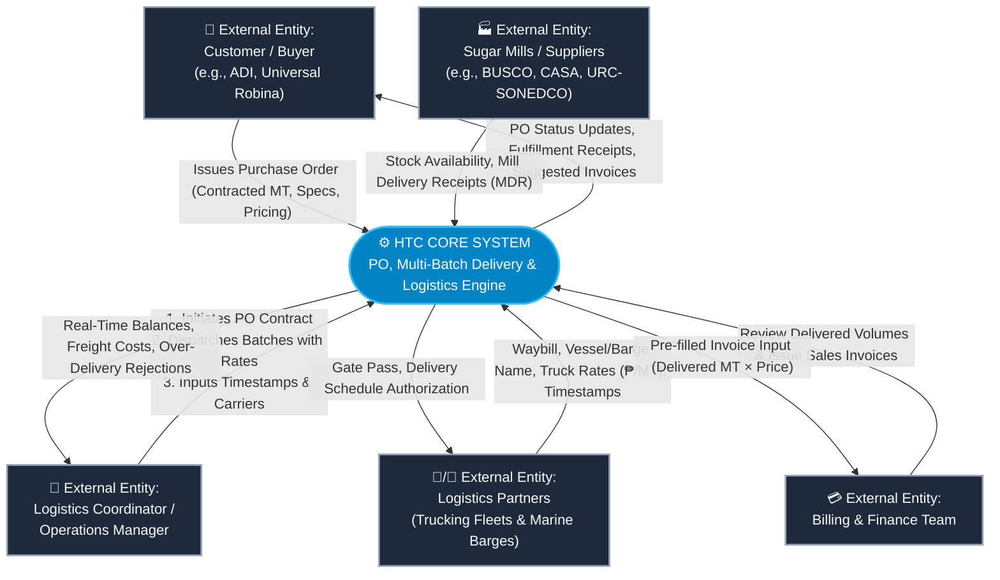
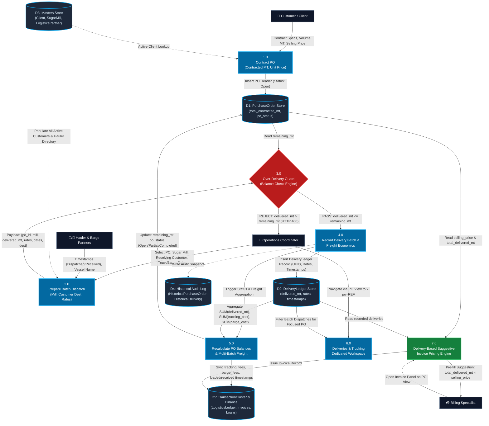

# Data Flow Diagram (DFD): Parent-Child Purchase Order & Incremental Delivery Engine

**System:** HTC Core Trading & Logistics Platform  
**Module:** Purchase Orders & Multi-Source Incremental Delivery Ledger  
**Version:** 2.2.0  
**Status:** Deployed & Verified (Production EC2)  
**Date:** October 11, 2026  

---

## 1. Executive Summary & Context

Prior to this implementation, the platform recorded trade logistics through a flat, single-dispatch assumption (1 Purchase Order = 1 Supplier Delivery). As discovered during stakeholder interviews, real-world raw/refined sugar trade involves:
- **Contract Splitting Across Locations & Customers:** A single contracted PO (e.g., 6,000 MT) is partitioned across multiple drop-off facilities (e.g., 2,000 MT to ADI, 2,000 MT to HTC Tank, 2,000 MT to Balayan, or dynamically dispatched to any active customer destination).
- **Multi-Source Sourcing:** A single customer contract (e.g., ADI 10,000 MT PO) is sourced from multiple sugar mills over time (e.g., 2,000 MT from BUSCO, 3,000 MT from CASA, etc.) depending on mill inventory availability.
- **Multi-Batch Logistics & Dynamic Freight Rates:** Each delivery batch carries distinct trucking routes (₱/MT), marine barging rates (₱/MT), carrier partners, vessel/barge assignments, dispatch departure times, and arrival timestamps.
- **Delivery-Based Suggestive Invoicing:** Customer billing automatically suggests the exact delivered shipment value (`total_delivered_mt * selling_price` or unbilled delivered balance) directly on the invoice panel.
- **Architectural Separation of Concerns:** The PO view retains fulfillment progress and the delivery ledger audit, but raw logistics management is linked directly to the dedicated PO workspace in the Deliveries & Trucking tab (`/operations/deliveries/?po=<PO_REF>`).

---

## 2. Level 0 DFD: Context Diagram

The Context Diagram outlines the external entities interacting with the HTC Core System boundary for PO contracting, fulfillment, and multi-batch logistics.

---

## 3. Level 1 DFD: Process Decomposition Diagram

The Level 1 DFD decomposes the system into operational processes, showcasing how data flows between coordinators, validation guards, multi-batch logistics aggregators, and the invoice suggestion engine.

---

## 4. Multi-Batch Logistics & Rate Architecture

### How Multiple Deliveries / Batches Handle Trucking & Barging Rates:
1. **Per-Batch Granularity:**
   - Each `DeliveryLedger` record stores its own:
     - `trucking_partner` & `trucking_rate_per_mt` (₱/MT).
     - `barge_partner`, `vessel_or_barge_name`, & `barge_rate_per_mt` (₱/MT).
     - `dispatched_at` (mill departure timestamp) & `received_at` (destination arrival timestamp).
2. **Deterministic Cost Computation:**
   - $\text{trucking\_cost} = \text{delivered\_mt} \times \text{trucking\_rate\_per\_mt}$
   - $\text{barge\_cost} = \text{delivered\_mt} \times \text{barge\_rate\_per\_mt}$
   - $\text{total\_freight\_cost} = \text{trucking\_cost} + \text{barge\_cost}$
3. **Automatic Cluster Synchronization:**
   - Upon saving any delivery batch, `sync_cluster_logistics()` recalculates:
     - `cluster.logistics.tracking_fees = SUM(d.trucking_cost for all deliveries)`
     - `cluster.logistics.barge_fees = SUM(d.barge_cost for all deliveries)`
     - `cluster.logistics.loaded_at = MIN(dispatched_at)`
     - `cluster.logistics.received_at = MAX(received_at)`
     - `cluster.logistics.received_volume_mt = po.total_delivered_mt`
   - This keeps executive P&L dashboards, loan prerequisite checks, and financial debriefs 100% accurate without manual data re-entry.

---

## 5. Delivery-Based Suggestive Invoicing Flow

1. **Auto-Suggestion Equation:**
   $$\text{Delivered Total} = \text{total\_delivered\_mt} \times \text{selling\_price}$$
   $$\text{Unbilled Delivered Balance} = \max(0, \text{Delivered Total} - \text{already\_invoiced})$$
2. **Reactive Panel Display:**
   - When recorded deliveries exist and have unbilled balances, the invoice issuance panel on the PO view displays an alert banner detailing:
     - Delivered MT & Customer Unit Price.
     - Total Delivered Sales Value.
     - "Apply Delivered" one-click action button that populates the invoice input field.
3. **Form Pre-Filling:**
   - `InvoiceForm` automatically sets its default initial amount to the unbilled delivered amount when shipment deliveries are present.

---

## 6. Separation of Concerns: PO View vs. Deliveries & Trucking Hub

- **PO View (`cluster_detail.html`):**
  - Displays contracted volume, fulfillment percentage, remaining MT, and an audit table of delivery batches.
  - Legacy standalone logistics edit forms have been removed to eliminate clutter and prevent operational confusion.
  - Features a prominent **"Open Deliveries & Trucking Tab"** link navigating directly to `/operations/deliveries/?po=<PO_REF>`.
- **Deliveries & Trucking Tab (`deliveries_list.html`):**
  - Automatically activates a **"Focused PO Logistics Workspace"** banner when accessed via `?po=<REF>`.
  - Aggregates focused PO metrics: total delivered MT, total land trucking costs, total marine barging costs, and aggregate logistics expenditure.
  - Lists individual batch dispatch/arrival timestamps, carrier assignments, and per-MT rates.
