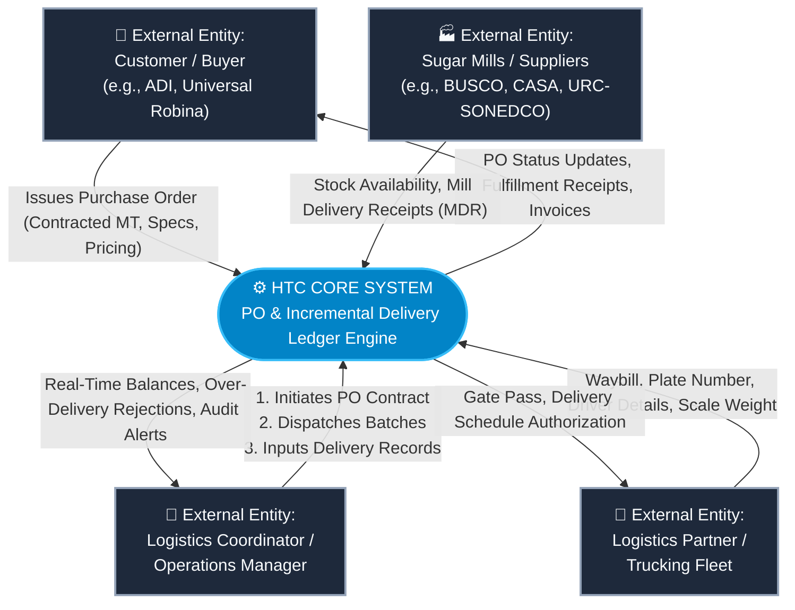
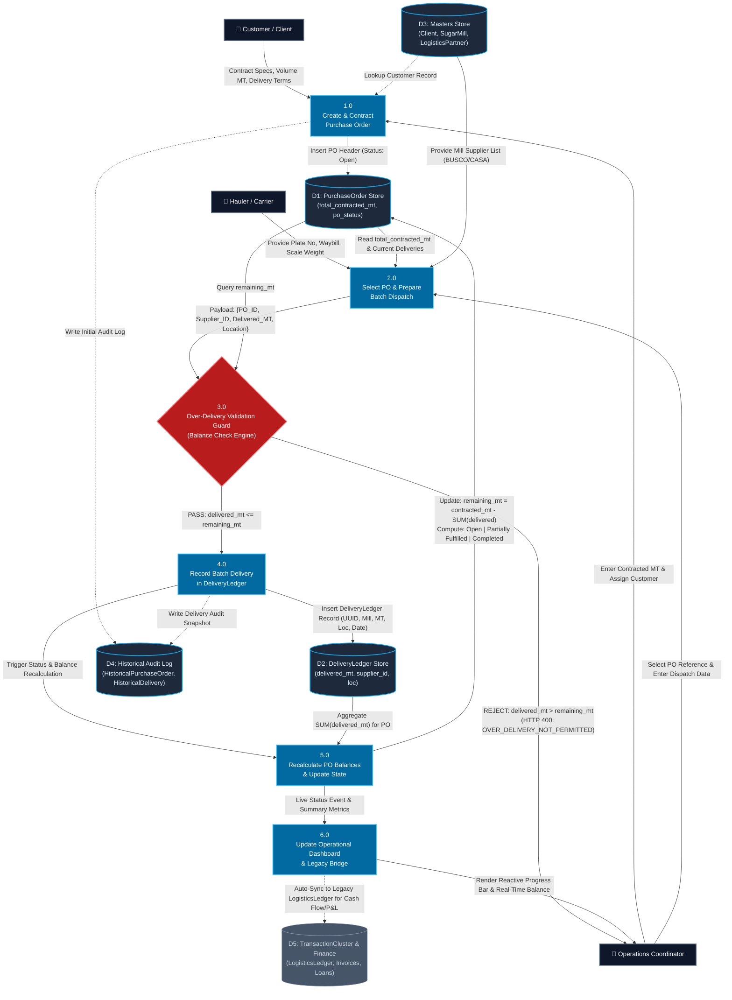

# Data Flow Diagram (DFD): Parent-Child Purchase Order & Incremental Delivery Engine

**System:** HTC Core Trading & Logistics Platform  
**Module:** Purchase Orders & Multi-Source Incremental Delivery Ledger  
**Version:** 2.1.0  
**Status:** Deployed & Verified (Production EC2)  
**Date:** October 11, 2026  

---

## 1. Executive Summary & Context

Prior to this implementation, the platform recorded trade logistics through a flat, single-dispatch assumption (1 Purchase Order = 1 Supplier Delivery). As discovered during stakeholder interviews, real-world raw/refined sugar trade involves:
- **Contract Splitting Across Locations:** A single contracted PO (e.g., 6,000 MT) is often partitioned across multiple drop-off facilities (e.g., 2,000 MT to ADI, 2,000 MT to HTC Tank, 2,000 MT to Balayan).
- **Multi-Source Sourcing:** A single customer contract (e.g., ADI 10,000 MT PO) is sourced from multiple sugar mills over time (e.g., 2,000 MT from BUSCO, 3,000 MT from CASA, etc.) depending on mill inventory availability.
- **Incremental Fulfillment Lifecycles:** Deliveries do not occur all at once. Fulfillment occurs incrementally across weeks or months, progressing from `Open` to `Partially Fulfilled` to `Completed`.

This document illustrates the **Data Flow Architecture** at Level 0 (Context Diagram) and Level 1 (Decomposition Diagram), documenting data transformations, inputs/outputs, validation boundaries, and persistence data stores.

---

## 2. Level 0 DFD: Context Diagram

The Context Diagram outlines the external entities interacting with the HTC Core System boundary for PO contracting and fulfillment.



---

## 3. Level 1 DFD: Process Decomposition Diagram

The Level 1 DFD decomposes the system into 6 core operational processes, showcasing how data flows between coordinators, validation guards, persistence stores, and legacy financial adapters.



---

## 4. Data Dictionary & Element Breakdown

| Data Element | Type | Source | Destination | Validation / Business Rules |
| :--- | :--- | :--- | :--- | :--- |
| `po_reference_number` | String (100) | Customer / Operations | `PurchaseOrder` (D1) | Unique business reference (e.g. `PO-ADI-2026-001`). Indexed. |
| `customer` | Foreign Key | `Client` (D3) | `PurchaseOrder` (D1) | Must reference active corporate client. |
| `total_contracted_mt` | Decimal(12,2) | Contract Terms | `PurchaseOrder` (D1) | Must be strictly > 0.00 MT. Backward-compatible with `volume_mt`. |
| `delivered_mt` | Decimal(12,2) | Scale Ticket / Hauler | `DeliveryLedger` (D2) | Must be > 0.00 MT and $\le$ `remaining_mt`. |
| `supplier` | Foreign Key | `SugarMill` (D3) | `DeliveryLedger` (D2) | Dynamic per delivery batch (e.g., BUSCO, CASA, URC). |
| `receiving_location` | String (255) | Shipping Instructions | `DeliveryLedger` (D2) | Physical receiving destination (e.g. ADI Plant, HTC Tank, Balayan). |
| `po_status` | Enum String | System Engine (P5) | `PurchaseOrder` (D1) | - `Open`: Delivered = 0 MT<br/>- `Partially Fulfilled`: 0 < Delivered < Contracted<br/>- `Completed`: Delivered $\ge$ Contracted |
| `remaining_mt` | Calculated | System Engine (P5) | API / UI (P6) | Formula: $\max(0, \text{total\_contracted\_mt} - \sum \text{delivered\_mt})$. |

---

## 5. Security & Boundary Guard Rails

1. **Client-Side Reactive Guard:**
   - Real-time JavaScript event listeners on `#id_delivered_mt` dynamically read data attributes `data-remaining-mt`.
   - Disables submission button and renders red warning banners if the user attempts to enter a value higher than the available balance.

2. **Server-Side Transactional Integrity (`clean()` & `save()`):**
   - Django ORM `clean()` method calculates `existing_delivered = SUM(all other deliveries for PO)`.
   - Prevents race conditions and guarantees no over-deliveries can be committed via ORM or Direct SQL.

3. **RESTful API Validation (`POST /deliveries`):**
   - Evaluates payload before serialization.
   - Throws deterministic HTTP `400 Bad Request` with standardized payload:
     ```json
     {
       "error": "Delivered quantity (4000.00 MT) exceeds remaining PO contracted quantity (2000.00 MT).",
       "code": "OVER_DELIVERY_NOT_PERMITTED",
       "remaining_mt": 2000.00
     }
     ```

4. **Audit Trail Immutability:**
   - Powered by `django-simple-history`.
   - Every delivery addition, adjustment, or cancellation creates immutable change snapshots in `HistoricalDeliveryLedger` and updates `HistoricalPurchaseOrder`.
