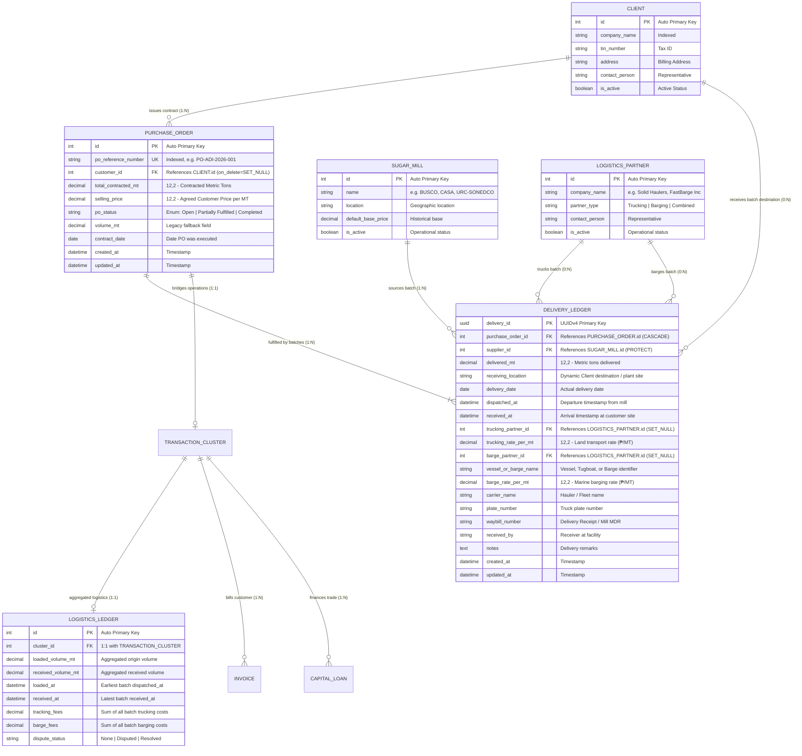

# Database Schema Diagram: Purchase Order, Multi-Batch Delivery Ledger & Freight Economics

**System:** HTC Core Trading & Logistics Platform  
**Database:** PostgreSQL 16  
**Application Apps:** `operations`, `masters`, `finance`  
**Schema Version:** Post-Migration `operations.0015_deliveryledger_barge_partner_and_more`  
**Date:** October 11, 2026  

---

## 1. Entity-Relationship Diagram (ERD)

The following Mermaid diagram maps the database entities, primary keys (`PK`), foreign keys (`FK`), and cardinality relationships for the refactored Parent-Child Purchase Order, Multi-Source Delivery Ledger, and Multi-Batch Freight Rate Economics module.



---

## 2. Table Schemas & Data Constraints

### 2.1 Table: `operations_deliveryledger`

| Column Name | Data Type | Nullable | Default | Description & Constraints |
| :--- | :--- | :---: | :---: | :--- |
| `delivery_id` | `uuid` | No | `uuid4()` | **Primary Key** |
| `purchase_order_id` | `bigint` | No | — | **FK** $\to$ `operations_purchaseorder.id` on `CASCADE` |
| `supplier_id` | `bigint` | No | — | **FK** $\to$ `masters_sugarmill.id` on `PROTECT` |
| `delivered_mt` | `numeric(12,2)` | No | `0.00` | Metric tons delivered. Guarded by `clean()` against PO balance. |
| `receiving_location` | `varchar(255)` | No | — | Drop-off destination (populated from `Client.name`). |
| `delivery_date` | `date` | No | `now()` | Date delivery was completed. |
| `dispatched_at` | `timestamptz` | Yes | `null` | Exact departure timestamp from the source sugar mill. |
| `received_at` | `timestamptz` | Yes | `null` | Exact arrival/intake timestamp at customer facility. |
| `trucking_partner_id`| `bigint` | Yes | `null` | **FK** $\to$ `masters_logisticspartner.id` on `SET_NULL` |
| `trucking_rate_per_mt`| `numeric(12,2)`| No | `0.00` | Land freight rate (₱/MT). |
| `barge_partner_id` | `bigint` | Yes | `null` | **FK** $\to$ `masters_logisticspartner.id` on `SET_NULL` |
| `vessel_or_barge_name`| `varchar(100)`| No | `''` | Marine vessel name / barge identifier. |
| `barge_rate_per_mt` | `numeric(12,2)`| No | `0.00` | Marine freight rate (₱/MT). |
| `carrier_name` | `varchar(150)` | No | `''` | Hauler name / fleet description. |
| `plate_number` | `varchar(50)` | No | `''` | Tractor or trailer license plate. |
| `waybill_number` | `varchar(100)` | No | `''` | Mill Delivery Receipt / Waybill number. |
| `received_by` | `varchar(100)` | No | `''` | Receiving checker / warehouse supervisor. |
| `notes` | `text` | No | `''` | Operational remarks. |

### 2.2 Calculated & Derived Properties on `DeliveryLedger`

```python
@property
def trucking_cost(self) -> Decimal:
    """Delivered volume MT multiplied by land trucking rate per MT."""
    return (self.delivered_mt * (self.trucking_rate_per_mt or Decimal("0.00"))).quantize(Decimal("0.01"))

@property
def barge_cost(self) -> Decimal:
    """Delivered volume MT multiplied by marine barge rate per MT."""
    return (self.delivered_mt * (self.barge_rate_per_mt or Decimal("0.00"))).quantize(Decimal("0.01"))

@property
def total_freight_cost(self) -> Decimal:
    """Total combined logistics cost for this individual delivery batch."""
    return self.trucking_cost + self.barge_cost
```

---

## 3. Database Indices & Optimization Strategy

1. **`purchase_order_id` Index:**
   - Enables sub-millisecond aggregation of all delivery batches for a Purchase Order (`deliveries.all()`).
2. **`supplier_id` Index:**
   - Enables real-time reporting of volumes sourced by sugar mill across all active contracts.
3. **`dispatched_at` & `received_at` Indices:**
   - Powers chronological sorting and earliest/latest transit milestone derivation for cluster synchronization.
