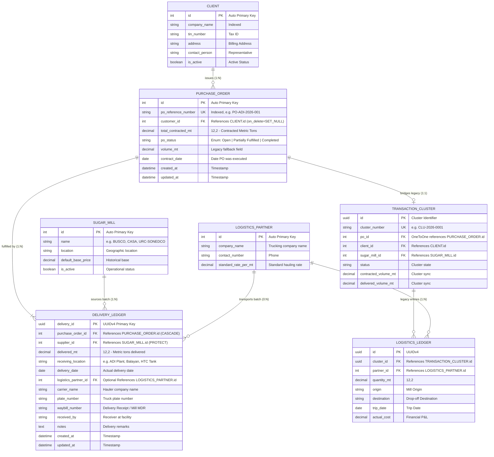
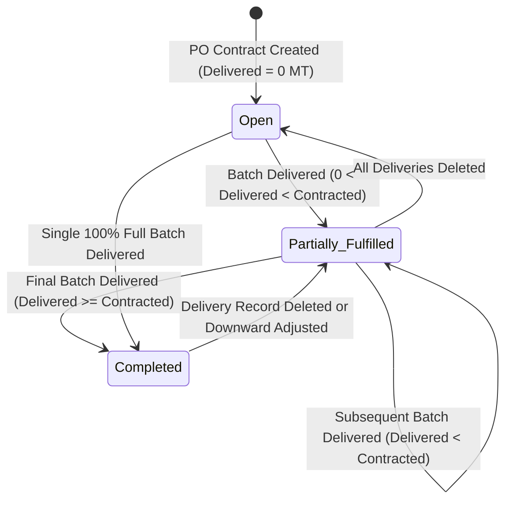

# Database Schema Diagram: Purchase Order & Incremental Delivery Ledger

**System:** HTC Core Trading & Logistics Platform  
**Database:** PostgreSQL 16  
**Application Apps:** `operations`, `masters`, `finance`  
**Schema Version:** Post-Migration `operations.0014_backfill_po_and_deliveries`  
**Date:** October 11, 2026  

---

## 1. Entity-Relationship Diagram (ERD)

The following Mermaid diagram maps the database entities, primary keys (`PK`), foreign keys (`FK`), and cardinality relationships for the refactored Parent-Child Purchase Order and Multi-Source Delivery Ledger module.

---

## 2. Table Specifications & Schema Definitions

### 2.1. `operations_purchaseorder`
The parent contract header entity representing customer contractual commitments.

| Column Name | SQL Data Type | Nullable | Constraints & Defaults | Description |
| :--- | :--- | :---: | :--- | :--- |
| `id` | `INTEGER` | ❌ | Primary Key, Auto-increment | Unique PO database ID. |
| `po_reference_number` | `VARCHAR(100)` | ❌ | `INDEX`, `DEFAULT=''` | Official business reference number (e.g. `PO-2026-ADI-001`). |
| `customer_id` | `INTEGER` | ✔️ | `FK -> masters_client(id)` | Customer organization ordering the goods. |
| `total_contracted_mt` | `NUMERIC(12,2)` | ❌ | `DEFAULT=0.00`, `CHECK (>= 0)` | Total committed metric tons contracted. |
| `po_status` | `VARCHAR(30)` | ❌ | `INDEX`, `DEFAULT='Open'` | Status: `'Open'`, `'Partially Fulfilled'`, or `'Completed'`. |
| `volume_mt` | `NUMERIC(12,2)` | ❌ | Legacy fallback column | Preserved for 100% backward compatibility. |
| `contract_date` | `DATE` | ✔️ | Nullable | Date contract was finalized. |
| `created_at` | `TIMESTAMPTZ` | ❌ | Auto now add | Creation timestamp. |
| `updated_at` | `TIMESTAMPTZ` | ❌ | Auto now | Last modified timestamp. |

**Calculated Properties (ORM Engine):**
- `total_delivered_mt`: `SUM(deliveries__delivered_mt)` (returns `Decimal(0.00)` if no deliveries).
- `remaining_mt`: `max(0, total_contracted_mt - total_delivered_mt)`.
- `fulfillment_percentage`: `min(100.0, (total_delivered_mt / total_contracted_mt) * 100)`.

---

### 2.2. `operations_deliveryledger`
The child delivery transactional table tracking granular, multi-sourced batch deliveries.

| Column Name | SQL Data Type | Nullable | Constraints & Defaults | Description |
| :--- | :--- | :---: | :--- | :--- |
| `delivery_id` | `UUID` | ❌ | Primary Key, `gen_random_uuid()` | Immutable UUID identifier for each delivery batch. |
| `purchase_order_id` | `INTEGER` | ❌ | `FK -> operations_purchaseorder(id) ON DELETE CASCADE` | Parent Purchase Order being fulfilled. |
| `supplier_id` | `INTEGER` | ❌ | `FK -> masters_sugarmill(id) ON DELETE PROTECT` | Sourcing Sugar Mill (e.g., BUSCO, CASA, etc.). |
| `delivered_mt` | `NUMERIC(12,2)` | ❌ | `CHECK (delivered_mt > 0)` | Net scale metric tons delivered in this batch. |
| `receiving_location` | `VARCHAR(255)` | ❌ | Not null | Facility destination (e.g., ADI Plant, Balayan, HTC Tank). |
| `delivery_date` | `DATE` | ❌ | `DEFAULT=CURRENT_DATE` | Actual date delivered. |
| `carrier_name` | `VARCHAR(150)` | ✔️ | `DEFAULT=''` | Trucking company / hauler name. |
| `plate_number` | `VARCHAR(50)` | ✔️ | `DEFAULT=''` | Vehicle registration plate number. |
| `waybill_number` | `VARCHAR(100)` | ✔️ | `DEFAULT=''` | Delivery Receipt / Mill Waybill number. |
| `received_by` | `VARCHAR(150)` | ✔️ | `DEFAULT=''` | Receiving supervisor at customer plant/tank. |
| `notes` | `TEXT` | ✔️ | `DEFAULT=''` | Operational remarks or scale variance notes. |
| `created_at` | `TIMESTAMPTZ` | ❌ | Auto now add | Record creation timestamp. |
| `updated_at` | `TIMESTAMPTZ` | ❌ | Auto now | Record update timestamp. |

**Indexes & Performance Optimizations:**
- `CREATE INDEX idx_delivery_po ON operations_deliveryledger (purchase_order_id);`
- `CREATE INDEX idx_delivery_supplier ON operations_deliveryledger (supplier_id);`
- `CREATE INDEX idx_delivery_date ON operations_deliveryledger (delivery_date);`

---

## 3. Lifecycle State Machine

The Purchase Order state automatically transitions based on the cumulative delivery sum:

---

## 4. Historical Audit Tables (`django-simple-history`)

To meet ISO compliance and internal financial audit requirements, all changes create immutable rows in corresponding historical tables:
- `operations_historicalpurchaseorder`: Logs timestamp, modifying user, diff of contracted volume, and status transitions.
- `operations_historicaldeliveryledger`: Logs timestamp, modifying user, previous delivered MT, previous destination, and carrier adjustments.

---

## 5. Backward Compatibility Bridge Architecture

To prevent regressions across existing modules (e.g., invoices, driver loans, profit/loss calculations):
1. **Model Fallback Property:**
   - Any legacy code calling `po.volume_mt` receives the current `total_contracted_mt`.
2. **Dual-Sourcing Legacy Cluster Bridge:**
   - When a `DeliveryLedger` record is saved, an automated signal triggers `auto_sync_cluster_from_delivery()`.
   - If the PO is tied to a `TransactionCluster`, a synchronized entry is mirrored into `LogisticsLedger` with corresponding mill origin and destination.
   - Financial accounting, hauling expense calculations, and billing reports continue functioning without downtime.
