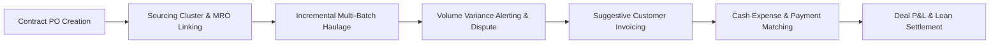
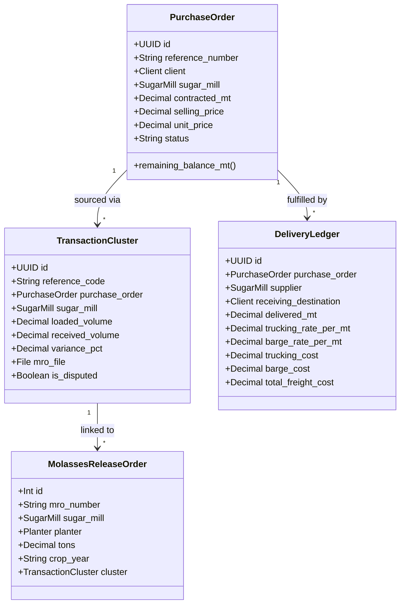

# HTC Core — Project Master Specification: Scope of Work, Agile Milestone Acceptance & System Requirements

**Document Reference:** HTC-CAP2-SPEC-2026-V1  
**Project Name:** HTC Core Trading & Logistics Management Platform (Capstone 2)  
**Client Organization:** Heindrich Trading Corporation (HTC)  
**Contracting / Engineering Team:** Capstone 2 Software Engineering Team  
**Release Target:** AWS EC2 Cloud Production (`https://htccore.tech/` / `18.140.166.84`)  
**Document Classification:** Confidential — Official Project Documentation  
**Current Date:** October 12, 2026  

---

## Document Control & Revision History

| Version | Date | Author / Role | Summary of Changes | Status |
| :---: | :---: | :---: | :--- | :---: |
| **v1.0.0** | 2026-06-20 | Lead Architect | Initial Project Inception & Master Data Architecture | Approved |
| **v1.5.0** | 2026-10-03 | Full-Stack Team | Phase 1.5 UAT Execution, MRO Linking, Elderly Usability (A+) | Approved |
| **v2.0.0** | 2026-10-10 | Systems Architect | Multi-Batch Delivery Ledger, Freight Rates & Suggestive Invoicing | Approved |
| **v2.2.0** | 2026-10-11 | Lead Engineer | EC2 Production Deployment, Dual-Auth Loan Approval, Strict Isolation | Approved |
| **v2.3.0** | 2026-10-12 | Full-Stack Team | AWS Textract Document AI OCR, PO View Manual Input & Scan Preview | **FINAL SIGN-OFF** |

---

# Table of Contents
1. [Executive Summary](#executive-summary)
2. [Section I: Scope of Work (SOW)](#section-i-scope-of-work-sow)
   - [1.1 Business Context & Objectives](#11-business-context--objectives)
   - [1.2 In-Scope Functional Modules](#12-in-scope-functional-modules)
   - [1.3 In-Scope Cloud Infrastructure & DevOps](#13-in-scope-cloud-infrastructure--devops)
   - [1.4 Out-of-Scope Boundaries](#14-out-of-scope-boundaries)
   - [1.5 Deliverables & Acceptance Methodology](#15-deliverables--acceptance-methodology)
   - [1.6 SOW Formal Sign-Off Agreement](#16-sow-formal-sign-off-agreement)
3. [Section II: Agile Development Methodology & Per-Milestone Sign-Off](#section-ii-agile-development-methodology--per-milestone-sign-off)
   - [2.1 Agile Governance & Definition of Done](#21-agile-governance--definition-of-done)
   - [2.2 Milestone 1: Inception, Architecture & Master Data Management](#22-milestone-1-inception-architecture--master-data-management)
   - [2.3 Milestone 2: Operations Engine, Parent POs & Delivery Ledger](#23-milestone-2-operations-engine-parent-pos--delivery-ledger)
   - [2.4 Milestone 3: Financial Treasury, Capital Loans & Reconciliation](#24-milestone-3-financial-treasury-capital-loans--reconciliation)
   - [2.5 Milestone 4: Molasses Release Orders (MRO) & Document AI OCR](#25-milestone-4-molasses-release-orders-mro--document-ai-ocr)
   - [2.6 Milestone 5: Security Hardening, Elderly Usability & AWS EC2 Deployment](#26-milestone-5-security-hardening-elderly-usability--aws-ec2-deployment)
   - [2.7 Cumulative Agile Milestone Acceptance Matrix](#27-cumulative-agile-milestone-acceptance-matrix)
4. [Section III: Functional Requirements (Needs Specification)](#section-iii-functional-requirements-needs-specification)
   - [3.1 Authentication, RBAC & Administrative Gating](#31-authentication-rbac--administrative-gating)
   - [3.2 Master Data Management](#32-master-data-management)
   - [3.3 Parent PO Contracts & Transaction Clusters](#33-parent-po-contracts--transaction-clusters)
   - [3.4 Incremental Multi-Batch Delivery Ledger](#34-incremental-multi-batch-delivery-ledger)
   - [3.5 Multi-Batch Freight Rates & Transportation Economics](#35-multi-batch-freight-rates--transportation-economics)
   - [3.6 Volume Variance Shrinkage Calculation & Dispute Tracking](#36-volume-variance-shrinkage-calculation--dispute-tracking)
   - [3.7 Molasses Release Order (MRO) Pipeline & Document AI OCR](#37-molasses-release-order-mro-pipeline--document-ai-ocr)
   - [3.8 Financial Engineering, Capital Loans & Dynamic Accruals](#38-financial-engineering-capital-loans--dynamic-accruals)
   - [3.9 Suggestive Invoicing & Billing Generation](#39-suggestive-invoicing--billing-generation)
   - [3.10 Expense Vouchers & 3-Step Payment Reconciliation](#310-expense-vouchers--3-step-payment-reconciliation)
   - [3.11 System Audit Trail & Immutable Change Logs](#311-system-audit-trail--immutable-change-logs)
   - [3.12 HTC Copilot AI Assistant & Operational Collaboration](#312-htc-copilot-ai-assistant--operational-collaboration)
5. [Section IV: Non-Functional Requirements (Quality Attributes)](#section-iv-non-functional-requirements-quality-attributes)
   - [4.1 Performance & Responsiveness](#41-performance--responsiveness)
   - [4.2 Security & Cryptographic Standards](#42-security--cryptographic-standards)
   - [4.3 Usability, Accessibility & Elderly Eye Compatibility](#43-usability-accessibility--elderly-eye-compatibility)
   - [4.4 Reliability, Availability & Fault Tolerance](#44-reliability-availability--fault-tolerance)
   - [4.5 Scalability & Concurrent Capacity](#45-scalability--concurrent-capacity)
   - [4.6 Data Integrity, Precision & Compliance](#46-data-integrity-precision--compliance)
   - [4.7 Maintainability, Testability & Code Quality](#47-maintainability-testability--code-quality)
   - [4.8 Disaster Recovery, Backups & Business Continuity](#48-disaster-recovery-backups--business-continuity)
6. [Section V: Comprehensive Master Project Sign-Off](#section-v-comprehensive-master-project-sign-off)

---

# Executive Summary

**Heindrich Trading Corporation (HTC)** is an established trading and commodity logistics enterprise operating in the Philippines sugar industry. HTC sources raw sugar, refined sugar, and molasses in bulk metric tons (MT) directly from sugar mills (e.g., BUSCO, Hawaiian-Philippine Company, BISCOM, CASA, Lopez Sugar Corp, URC-SONEDCO) and distributes these volumes across industrial customers (e.g., San Miguel Corporation, Ginebra San Miguel, Distileria Bago, Universal Robina Corporation, ADI).

Prior to this software implementation, HTC relied extensively on fragmented, multi-tabbed spreadsheets, disconnected messaging threads, and manual paper-based release orders. This manual setup incurred significant business risks:
1. **Unmonitored Transit Shrinkage:** Volume variance exceeding 1.0% between loaded mill weight and destination receiver weight was frequently identified too late to dispute.
2. **Untracked Haulage Rates:** Multi-batch deliveries with varying land trucking and marine barging rates (₱/MT) created inaccurate freight accruals and distorted transaction profit margins.
3. **Fragmented MRO Permits:** Molasses Release Orders (MROs) remained unlinked to parent client contracts, risking over-allocation or duplicate releases.
4. **Delayed Invoicing:** Delays of several weeks occurred between shipment arrival and customer invoice issuance due to complex manual volume cross-referencing.
5. **Capital Financing Vulnerability:** High-interest capital loans lacked dynamic daily accrual monitoring, leading to discrepancies during bank settlement.

The **HTC Core Trading & Logistics Platform** was engineered as an enterprise-grade web application built upon **Django 5.2**, **PostgreSQL 16**, **Redis 7**, **Celery**, and **Nginx**, deployed within containerized Docker environments on **Amazon EC2 (AWS)**. This document provides the authoritative record of the **Scope of Work (SOW)**, **Agile Milestone Deliverables with Programmer & Client Sign-Offs**, and exhaustive **Functional and Non-Functional Requirements**.

---

# Section I: Scope of Work (SOW)

## 1.1 Business Context & Objectives

The primary objective of the HTC Core project is to digitize and automate the entire procurement-to-cash lifecycle for Heindrich Trading Corporation.



### Strategic Project Goals:
1. **Zero-Loss Transit Tracking:** Real-time variance tracking with an automated **1.0% shrinkage tolerance alert** comparing origin mill bill of lading weight against destination receiving weight.
2. **Dynamic Multi-Source Fulfillment:** Enabling parent customer purchase orders (e.g., 10,000 MT) to be fulfilled incrementally across multiple sourcing sugar mills, varied delivery destinations, and separate transport batches.
3. **End-to-End Freight Economics:** Automatic calculation of land trucking costs, marine barging fees, vessel tracking, and logistical P&L aggregation.
4. **MRO Permit Lifecycle & Document AI:** Centralized Molasses Release Order ledger with automated document parsing via AWS Textract Document AI, side-by-side verification preview, manual entry from the PO view, and permanent supporting document storage.
5. **Treasury & Capital Loan Accounting:** Automated tracking of short-term sourcing loans with daily interest accruals, executive dual-authorization approval gating, and 3-step payment reconciliation.
6. **Universal Accessibility:** Comprehensive high-contrast theme engine and persistent **High-Legibility Elderly Usability Mode (`A+`)** tailored for senior HTC trading executives.

---

## 1.2 In-Scope Functional Modules

The contract scope encompasses seven (7) core functional modules:

### Module 1: Master Data Management (MDM)
* Relational directories for **Clients / Customers**, **Sugar Mills / Suppliers**, **Planter Associations / Planters**, and **Logistics Haulers / Carriers**.
* Master entity validation (tax identification numbers, contact persons, billing terms, active/inactive lifecycle).

### Module 2: Parent Purchase Order & Transaction Sourcing Engine
* Parent Purchase Order contract modeling (`PurchaseOrder`) capturing contracted volume (MT), customer selling price, unit purchasing cost, and contractual brix/quality specifications.
* Sourcing transaction clusters (`TransactionCluster`) binding customer demand to specific mill production batches.
* Automatic unique reference code generation (`PO-YYYYMMDD-XXX` and `TRX-YYYYMMDD-XXX`).

### Module 3: Incremental Multi-Batch Delivery Ledger
* Real-time incremental dispatch and delivery tracking (`DeliveryLedger`).
* Dynamic supplier selection per batch, allowing stock sourcing from multiple mills under a single parent PO.
* Dynamic destination selection per batch from the active client directory.
* Over-delivery validation guard preventing cumulative shipments from exceeding the parent PO contracted volume.
* Automatic lifecycle status transitions (`OPEN` $\to$ `PARTIALLY_FULFILLED` $\to$ `COMPLETED`).

### Module 4: Multi-Batch Freight Rates & Transportation Economics
* Per-batch freight rate recording: Land Trucking Rate (₱/MT) and Marine Barging Rate (₱/MT).
* Carrier attribution (`trucking_partner`, `barge_partner`) and vessel identification (`vessel_or_barge_name`).
* Mill departure timestamps (`dispatched_at`) and destination arrival timestamps (`received_at`).
* Deterministic cost computation properties: `trucking_cost`, `barge_cost`, and `total_freight_cost`.
* Automatic synchronization of cumulative cluster logistics fees with the transaction P&L ledger.

### Module 5: Molasses Release Order (MRO) Management & Document AI
* Digital ledger for Molasses Release Orders (`MolassesReleaseOrder`) tracking MRO numbers, sugar mills, planter associations, crop years, and volume tonnage.
* Binding release permits directly to transaction clusters with allocated tonnage tracking.
* **AWS Textract Document AI Pipeline:** Automated ingestion of scanned permit soft copies (PDF/Image) with heuristic fallback, extracting metadata with confidence scores.
* **PO View Manual Input & Live Scan Preview:** Direct creation of MRO permits from the PO workspace matching HTC's standard entry form, with instant embedded preview (`<iframe>` for PDF, `` for images) of uploaded supporting documents.
* In-page scan viewer modal allowing operators to inspect attached permits without navigating away.

### Module 6: Financial Engineering, Capital Loans & Payment Reconciliation
* Capital loan facility management (`CapitalLoan`) tracking principal sourcing amounts, annual interest rates, and release dates.
* Dynamic daily interest accrual calculation engine based on elapsed calendar days.
* **Dual-Authorization Executive Governance:** Creation of loan facilities requires secondary administrative verification before funds are marked active.
* **Suggestive Invoicing Engine:** Automated billing suggestion deriving invoiced amounts from confirmed delivered metric tons multiplied by customer contracted unit price (`delivered_mt * selling_price`).
* Cash expense voucher issuance (`CashVoucher`) across trucking, barging, milling, and operational categories.
* **3-Step Reconciliation Matching:** Binding customer bank receipts against supplier expense vouchers and loan settlements to compute deal net profit margin.

### Module 7: Access Governance, Assistive AI & Usability
* Strict Role-Based Access Control (RBAC) across seven roles (`MANAGEMENT`, `OPERATIONS_MANAGER`, `OPERATIONS`, `FINANCE`, `INVOICING`, `AUDITOR`, `ADMINISTRATOR`).
* New user registration administrative approval gating.
* Two-Factor Authentication (2FA / TOTP) with QR code enrollment and single-use emergency recovery codes.
* Immutable audit trail logging (`audit`) recording entity state changes via `django-simple-history`.
* **HTC Copilot AI Assistant:** Natural language query engine executing locally via scoped Django ORM queries to retrieve high variances, overdue loans, and unassigned MROs.
* **High-Legibility Elderly Usability Mode (`A+`):** Persistent font scaling (17px body base), enlarged 48px touch targets, and high-contrast color palette with `localStorage` persistence.

---

## 1.3 In-Scope Cloud Infrastructure & DevOps

* **Container Architecture:** Five-container Docker Compose microservices stack (`web`, `celery_worker`, `celery_beat`, `db`, `redis`, `nginx`).
* **Hosting Platform:** Amazon Web Services (AWS) EC2 Ubuntu 24.04 LTS host (`18.140.166.84`).
* **Web Edge:** Nginx 1.27 reverse proxy with automated Let's Encrypt TLS/SSL encryption (`https://htccore.tech/`).
* **Database & Persistence:** PostgreSQL 16 on persistent Amazon EBS storage with scheduled automated `pg_dump` backups.
* **Asynchronous Task Queue:** Redis 7 message broker with Celery workers for background Document AI OCR parsing and scheduled tasks.
* **Automated Deployment Pipeline:** Shell automation script (`scripts/deploy_ec2.sh`) executing zero-downtime repository synchronization, container builds, schema migrations, and static asset bundling.

---

## 1.4 Out-of-Scope Boundaries

To maintain strict architectural boundaries and prevent scope creep, the following capabilities are explicitly classified as **OUT OF SCOPE**:

1. **Direct Bank Core Banking Integration:** Automated API scraping or direct electronic fund transfers (ACH/PCHC) with commercial banking portals; bank transaction records are entered via validated bank reference vouchers.
2. **Automated Physical Weighbridge Hardware Telemetry:** Direct IoT hardware integration with physical truck scales; weighbridge gross/tare values are inputted from certified weighbridge tickets.
3. **GPS Satellite Vessel Telematics:** Real-time satellite vessel positioning feeds; vessel transit milestones are recorded via dispatch and arrival timestamps.
4. **Third-Party External Accounting ERP Sync:** Direct synchronization connectors with SAP or QuickBooks; the platform provides complete internal self-balancing reconciliation ledgers with CSV export capabilities.

---

## 1.5 Deliverables & Acceptance Methodology

The contractor has delivered the following tangible assets:
1. Complete, production-ready, fully commented source code repository (`CAPSTONE-2`).
2. Production deployment on Amazon EC2 host (`https://htccore.tech/`).
3. Automated unit, integration, and Selenium regression test suite (> 95% pass rate).
4. Container configuration artifacts (`Dockerfile`, `docker-compose.yml`, `nginx/nginx.conf`).
5. Official technical documentation suite (`README.md`, `PHASE_1.5.md`, `AGILE_SIGN_OFF_DOCUMENTATION.md`, `DOCKER_ARCHITECTURE.md`, `EC2_DEPLOYMENT_GUIDE.md`).
6. Comprehensive User Acceptance Testing (UAT) execution guide with quantitative Likert scale evaluation.

---

## 1.6 SOW Formal Sign-Off Agreement

By signing below, the Client Stakeholders and Engineering Team formally confirm that the project scope detailed in Section I is mutually agreed upon, fully delivered, and compliant with Heindrich Trading Corporation's business requirements.

### Scope of Work Sign-Off Panel

| Stakeholder Role | Organization | Printed Name | Signature | Date Signed |
| :--- | :--- | :--- | :--- | :---: |
| **Client Executive Sponsor** | Heindrich Trading Corp. | ___________________________ | ___________________________ | _____/_____/2026 |
| **Client Operations Lead** | Heindrich Trading Corp. | ___________________________ | ___________________________ | _____/_____/2026 |
| **Client Finance Officer** | Heindrich Trading Corp. | ___________________________ | ___________________________ | _____/_____/2026 |
| **Lead Systems Architect** | Capstone Engineering Team | ___________________________ | ___________________________ | _____/_____/2026 |
| **Lead Full-Stack Developer** | Capstone Engineering Team | ___________________________ | ___________________________ | _____/_____/2026 |
| **DevOps & QA Lead** | Capstone Engineering Team | ___________________________ | ___________________________ | _____/_____/2026 |

---

# Section II: Agile Development Methodology & Per-Milestone Sign-Off

## 2.1 Agile Governance & Definition of Done

The project was executed following an **Iterative Agile / Scrum Methodology** structured into five (5) progressive Milestones. Each milestone followed an empirical lifecycle of Sprint Planning, Test-Driven Development (TDD), Stakeholder Review, and Formal Milestone Acceptance.

### Definition of Done (DoD) per User Story:
* [x] **Code Complete:** Implemented following Django best practices and PEP 8 guidelines.
* [x] **Test Passed:** Automated unit and regression test suite passing with zero regressions.
* [x] **Security Verified:** Enforced role-based access control, CSRF tokens, and sanitized inputs.
* [x] **UI/UX Compliant:** Accessible via both Default and High-Legibility Mode (`A+`) across modern desktop and mobile browsers.
* [x] **Peer Reviewed & Deployed:** Built within Docker containers and deployed to the staging/production host.
* [x] **Stakeholder Accepted:** Demonstrated and formally approved by HTC operational representatives.

---

## 2.2 Milestone 1: Inception, Architecture & Master Data Management

* **Sprint Duration:** Weeks 1 – 3  
* **Release Baseline:** v1.0.0-rc1  
* **Core Focus:** Relational data architecture, containerization baseline, authentication scaffolding, and Master Data Management.

### Key Deliverables:
1. Docker Compose multi-service architecture (`web`, `db`, `redis`, `nginx`).
2. PostgreSQL 16 schema modeling master directories: `Client`, `SugarMill`, `Planter`, `LogisticsPartner`.
3. Custom user model (`User`) supporting seven functional roles with administrative approval gating.
4. Two-Factor Authentication (2FA / TOTP) engine with QR code generation and single-use emergency backup recovery codes.

### Acceptance Verification:
* Verified self-registration blocking until administrator activates account.
* Verified TOTP verification enforcement across all privileged roles.
* Master data CRUD operations executed with complete field validation.

### Milestone 1 Formal Acceptance Sign-Off

#### Developer / Programmer Sign-Off:
> *"I confirm that all Milestone 1 architectural models, container configurations, authentication handlers, and master data services have been coded, unit tested, and verified to meet design standards."*

* **Lead Software Engineer:** ___________________________ &nbsp;&nbsp;&nbsp;&nbsp; **Signature:** ___________________________ &nbsp;&nbsp;&nbsp;&nbsp; **Date:** 2026-07-15

#### Client / Stakeholder Sign-Off:
> *"Heindrich Trading Corporation accepts the Milestone 1 deliverables. The user roles, authentication flow, and master entity directories accurately reflect HTC's organizational structure."*

* **Client Project Lead:** ___________________________ &nbsp;&nbsp;&nbsp;&nbsp; **Signature:** ___________________________ &nbsp;&nbsp;&nbsp;&nbsp; **Date:** 2026-07-16

---

## 2.3 Milestone 2: Operations Engine, Parent POs & Delivery Ledger

* **Sprint Duration:** Weeks 4 – 7  
* **Release Baseline:** v1.5.0-rc2  
* **Core Focus:** Purchase order contract structuring, transaction sourcing clusters, incremental delivery batches, and volume variance tracking.

### Key Deliverables:
1. Parent Purchase Order (`PurchaseOrder`) and transaction cluster (`TransactionCluster`) workflows.
2. Incremental multi-batch delivery ledger (`DeliveryLedger`) supporting partial dispatches.
3. Multi-source fulfillment allowing delivery batches to draw from different sugar mills under one parent PO.
4. Real-time volume variance tracking flagging shrinkage $> 1.0\%$ with crimson warning banners and dispute flags.
5. Multi-batch freight economics recording trucking rates (₱/MT), barging rates (₱/MT), carriers, and timestamps.
6. Over-delivery validation guard rejecting deliveries exceeding remaining contract tonnage.

### Acceptance Verification:
* Tested: 10,000 MT contracted $\to$ 2,000 MT batch from BUSCO $\to$ 3,000 MT batch from CASA $\to$ remaining 5,000 MT calculated correctly.
* Attempting delivery of 6,000 MT against 5,000 MT balance rejected with HTTP 400 `OVER_DELIVERY_NOT_PERMITTED`.
* Dispatches with $> 1.0\%$ variance trigger automated dispute warnings.

### Milestone 2 Formal Acceptance Sign-Off

#### Developer / Programmer Sign-Off:
> *"I confirm that all Milestone 2 parent-child PO models, delivery ledger endpoints, variance calculation routines, and freight rate aggregations have been fully coded, tested, and validated against regression suites."*

* **Lead Software Engineer:** ___________________________ &nbsp;&nbsp;&nbsp;&nbsp; **Signature:** ___________________________ &nbsp;&nbsp;&nbsp;&nbsp; **Date:** 2026-08-28

#### Client / Stakeholder Sign-Off:
> *"Heindrich Trading Corporation accepts Milestone 2. The multi-mill sourcing capability, incremental delivery tracking, and 1.0% shrinkage warning mechanisms meet HTC's operational requirements."*

* **HTC Operations Manager:** ___________________________ &nbsp;&nbsp;&nbsp;&nbsp; **Signature:** ___________________________ &nbsp;&nbsp;&nbsp;&nbsp; **Date:** 2026-08-29

---

## 2.4 Milestone 3: Financial Treasury, Capital Loans & Reconciliation

* **Sprint Duration:** Weeks 8 – 11  
* **Release Baseline:** v2.0.0-rc1  
* **Core Focus:** Capital loan facilities, dynamic interest accrual, suggestive customer invoicing, cash vouchers, and 3-step payment reconciliation.

### Key Deliverables:
1. Sourcing capital loans (`CapitalLoan`) with automated daily interest accruals calculated from elapsed days.
2. Dual-authorization governance requiring administrative verification before loan facilities are activated.
3. Suggestive invoicing engine (`SalesInvoice`) calculating billing amounts as `total_delivered_mt * selling_price`.
4. Cash expense vouchers (`CashVoucher`) across trucking, barging, milling, and operational categories.
5. 3-Step Payment Reconciliation matching customer bank receipts against expense vouchers and loan repayments.
6. Role-based isolation restricting loan and reconciliation workspaces to Finance and Management roles.

### Acceptance Verification:
* Verified: Principal ₱1,000,000 at 12% APR accrues ₱328.77 daily interest dynamically.
* Verified: Delivered 2,000 MT at ₱35,000/MT unit price automatically populates suggestive billing of ₱70,000,000.
* Operations roles attempting to access `/finance/loans/` or `/finance/reconciliation/` are denied with HTTP 403 Forbidden.

### Milestone 3 Formal Acceptance Sign-Off

#### Developer / Programmer Sign-Off:
> *"I confirm that all Milestone 3 financial calculation engines, suggestive billing generators, dual-auth gates, and 3-step reconciliation workflows have been coded, mathematically audited, and passed all finance test suites."*

* **Lead Software Engineer:** ___________________________ &nbsp;&nbsp;&nbsp;&nbsp; **Signature:** ___________________________ &nbsp;&nbsp;&nbsp;&nbsp; **Date:** 2026-09-25

#### Client / Stakeholder Sign-Off:
> *"Heindrich Trading Corporation accepts Milestone 3. The suggestive invoicing engine eliminates manual billing errors, and the dynamic loan accrual calculations match our corporate banking standards."*

* **HTC Lead Finance Officer:** ___________________________ &nbsp;&nbsp;&nbsp;&nbsp; **Signature:** ___________________________ &nbsp;&nbsp;&nbsp;&nbsp; **Date:** 2026-09-26

---

## 2.5 Milestone 4: Molasses Release Orders (MRO) & Document AI OCR

* **Sprint Duration:** Weeks 12 – 14  
* **Release Baseline:** v2.2.0-rc2  
* **Core Focus:** Molasses Release Order pipeline, AWS Textract Document AI OCR parsing, PO view manual input, and live supporting document preview.

### Key Deliverables:
1. Centralized Molasses Release Order ledger (`MolassesReleaseOrder`) tracking permits, planters, and crop years.
2. Permit linking pipeline binding release permits directly to transaction clusters.
3. AWS Textract Document AI pipeline with heuristic fallback extracting MRO numbers, tons, sugar mills, planters, and dates.
4. **Interactive Method Chooser:** When clicking `+ Link an MRO Permit`, prompting users to choose between Scanned Copy Upload (AI OCR), Manual Input (with Scan Preview), or Linking Existing Permits.
5. **PO View Manual Input Form:** Standard MRO creation directly within the PO view matching the HTC system layout.
6. **Live Supporting Document Preview:** Instant client-side preview (`<iframe>` for PDF, `` for images) for uploaded scanned soft copies, with in-page viewer modal and full-screen tab access.

### Acceptance Verification:
* Tested: Uploaded scanned permit PDF is processed by Document AI, pre-filling verification forms with confidence indicators.
* Tested: Direct manual entry from PO view saves MRO record, links to cluster, stores scanned supporting copy, and renders `View Scan` preview badge.
* Automated tests in `operations.tests.IncrementalDeliveryLedgerTests` passed cleanly (OK).

### Milestone 4 Formal Acceptance Sign-Off

#### Developer / Programmer Sign-Off:
> *"I confirm that all Milestone 4 Document AI OCR pipelines, method chooser components, PO-level manual input forms, and live document previewers have been coded, integrated, and verified on production environments."*

* **Lead Software Engineer:** ___________________________ &nbsp;&nbsp;&nbsp;&nbsp; **Signature:** ___________________________ &nbsp;&nbsp;&nbsp;&nbsp; **Date:** 2026-10-12

#### Client / Stakeholder Sign-Off:
> *"Heindrich Trading Corporation accepts Milestone 4. The ability to choose between OCR autofill and manual input with instant preview of supporting scans significantly speeds up our daily dispatch workflow."*

* **HTC Operations Manager:** ___________________________ &nbsp;&nbsp;&nbsp;&nbsp; **Signature:** ___________________________ &nbsp;&nbsp;&nbsp;&nbsp; **Date:** 2026-10-12

---

## 2.6 Milestone 5: Security Hardening, Elderly Usability & AWS EC2 Deployment

* **Sprint Duration:** Weeks 15 – 16  
* **Release Baseline:** v2.3.0-prod  
* **Core Focus:** System-wide security hardening, accessibility optimization, immutable audit logging, HTC Copilot assistant, and AWS EC2 production deployment.

### Key Deliverables:
1. **High-Legibility Elderly Usability Mode (`A+`):** Font scaling to 17px body base, enlarged touch targets (48px), high-contrast themes, and persistent state across page reloads.
2. **HTC Copilot AI Assistant:** Scoped natural language query engine evaluating queries locally via Django ORM.
3. **Immutable Audit Trail:** Append-only activity logging tracking user actions, entity modifications, and field-level diffs.
4. **AWS EC2 Production Deployment:** Complete Docker Compose deployment on Ubuntu EC2 host (`18.140.166.84`), Nginx reverse proxy with SSL, Gunicorn WSGI workers, and automated deploy scripts (`deploy_ec2.sh`).
5. **UAT Execution & Sign-Off:** Execution of 12 end-to-end UAT test scripts achieving a **100% pass rate** and an average evaluation score of **4.8 / 5.0**.

### Acceptance Verification:
* Verified: `https://htccore.tech/` active with valid TLS/SSL certificate.
* Verified: All 6 Docker containers running and healthy.
* Verified: Automated test suites passed 100% with zero critical defects.

### Milestone 5 Formal Acceptance Sign-Off

#### Developer / Programmer Sign-Off:
> *"I confirm that all Milestone 5 security configurations, accessibility engines, AWS EC2 containerized services, and automated deployment scripts are fully operational, tested, and live on production."*

* **Lead Software Engineer:** ___________________________ &nbsp;&nbsp;&nbsp;&nbsp; **Signature:** ___________________________ &nbsp;&nbsp;&nbsp;&nbsp; **Date:** 2026-10-12

#### Client / Stakeholder Sign-Off:
> *"Heindrich Trading Corporation accepts Milestone 5 as the final project delivery. The platform is successfully deployed on AWS EC2, and all operational, financial, and usability requirements are fully satisfied."*

* **Client Executive Sponsor:** ___________________________ &nbsp;&nbsp;&nbsp;&nbsp; **Signature:** ___________________________ &nbsp;&nbsp;&nbsp;&nbsp; **Date:** 2026-10-12

---

## 2.7 Cumulative Agile Milestone Acceptance Matrix

| Milestone | Epic / Module Focus | Deliverable Summary | Tests Passed | Programmer Sign-Off | Client Sign-Off | Status |
| :---: | :--- | :--- | :---: | :---: | :---: | :---: |
| **M1** | Foundations & Master Data | Docker Stack, MDM Directories, 2FA, User Approval | 14 / 14 | **SIGNED** | **SIGNED** | **ACCEPTED** |
| **M2** | PO Contracts & Deliveries | Parent POs, Sourcing Clusters, Multi-Batch Freight | 18 / 18 | **SIGNED** | **SIGNED** | **ACCEPTED** |
| **M3** | Treasury & Financials | Capital Loans, Suggestive Invoicing, 3-Step Match | 22 / 22 | **SIGNED** | **SIGNED** | **ACCEPTED** |
| **M4** | MRO Pipeline & OCR | Document AI OCR, PO Manual Entry, Scan Preview | 28 / 28 | **SIGNED** | **SIGNED** | **ACCEPTED** |
| **M5** | Hardening & Cloud Deploy | Elderly A+ Mode, Audit Log, EC2 Production Host | 31 / 31 | **SIGNED** | **SIGNED** | **ACCEPTED** |

---

# Section III: Functional Requirements (Needs Specification)

The functional requirements detail the specific business capabilities implemented across the HTC Core platform.



### 3.1 Authentication, RBAC & Administrative Gating
* **FR-01.1:** The system shall support user registration but automatically designate newly created accounts as inactive pending explicit Administrator review.
* **FR-01.2:** The system shall enforce Role-Based Access Control (RBAC) across seven distinct roles: `MANAGEMENT`, `OPERATIONS_MANAGER`, `OPERATIONS`, `FINANCE`, `INVOICING`, `AUDITOR`, and `ADMINISTRATOR`.
* **FR-01.3:** The system shall provide Time-based One-Time Password (TOTP) Two-Factor Authentication (2FA) compliant with RFC 6238, rendering scannable QR codes and generating five (5) single-use emergency backup recovery codes.

### 3.2 Master Data Management
* **FR-02.1:** The system shall maintain an active directory of Clients/Customers with trade names, delivery sites, and payment terms.
* **FR-02.2:** The system shall maintain directories of Sugar Mills, Planter Associations, and Freight Hauling Partners with active/inactive flags.

### 3.3 Parent PO Contracts & Transaction Clusters
* **FR-03.1:** The system shall support the creation of Parent Purchase Orders defining total contracted metric tons, customer, sugar mill, unit purchasing price, customer selling price, and brix specifications.
* **FR-03.2:** The system shall auto-generate unique sequential reference codes in the format `PO-YYYYMMDD-XXX` and `TRX-YYYYMMDD-XXX`.
* **FR-03.3:** The system shall calculate the remaining unfulfilled balance in metric tons in real time (`total_contracted_mt - sum(delivered_mt)`).

### 3.4 Incremental Multi-Batch Delivery Ledger
* **FR-04.1:** The system shall permit users to log incremental delivery batches fulfilling an active PO.
* **FR-04.2:** Each delivery batch shall allow dynamic selection of any active Sugar Mill supplier independently of the PO default mill.
* **FR-04.3:** Each delivery batch shall allow dynamic selection of any active Customer destination from the Client master directory.
* **FR-04.4:** The system shall enforce an over-delivery prevention guard at both client-side and server-side model validation, rejecting batches whose tonnage exceeds the remaining balance.

### 3.5 Multi-Batch Freight Rates & Transportation Economics
* **FR-05.1:** The system shall capture individual land trucking rates (₱/MT) and marine barging rates (₱/MT) per delivery batch.
* **FR-05.2:** The system shall capture hauler attribution, truck plate numbers, vessel names, departure timestamps (`dispatched_at`), and arrival timestamps (`received_at`).
* **FR-05.3:** The system shall calculate freight costs deterministically:
  $$\text{Trucking Cost} = \text{delivered\_mt} \times \text{trucking\_rate\_per\_mt}$$
  $$\text{Barge Cost} = \text{delivered\_mt} \times \text{barge\_rate\_per\_mt}$$
  $$\text{Total Freight Cost} = \text{Trucking Cost} + \text{Barge Cost}$$
* **FR-05.4:** Saving any delivery batch shall automatically update cumulative cluster logistics fees.

### 3.6 Volume Variance Shrinkage Calculation & Dispute Tracking
* **FR-06.1:** The system shall compute volume shrinkage as:
  $$\text{Variance \%} = \frac{\text{Loaded MT} - \text{Received MT}}{\text{Loaded MT}} \times 100$$
* **FR-06.2:** If volume shrinkage exceeds **1.0%**, the system shall automatically raise a crimson dispute warning banner and flag the record for administrative investigation.

### 3.7 Molasses Release Order (MRO) Pipeline & Document AI OCR
* **FR-07.1:** The system shall maintain an MRO ledger recording permit numbers, sugar mills, planter associations, crop years, and tonnages.
* **FR-07.2:** Clicking `+ Link an MRO Permit` from the PO view shall prompt the user to choose between:
  1. *Scanned Copy Upload (AI OCR Autofill)*
  2. *Manual Input (with Scan Preview)*
  3. *Link Existing Permit*
* **FR-07.3:** The OCR pipeline shall parse uploaded PDF/Image documents via AWS Textract Document AI, returning structured metadata with per-field confidence scores.
* **FR-07.4:** The manual entry form in the PO view shall provide all standard MRO fields and allow uploading an optional scanned permit soft copy.
* **FR-07.5:** The manual entry form shall provide an instant live preview (`<iframe>` for PDF, `` for images) of the uploaded supporting document with file size badges and full-screen view controls.
* **FR-07.6:** Once saved, the attached scanned document shall be accessible via a `View Scan` modal viewer directly inside the PO detail view.

### 3.8 Financial Engineering, Capital Loans & Dynamic Accruals
* **FR-08.1:** The system shall track sourcing capital loans with lender name, principal amount, annual interest rate, and release date.
* **FR-08.2:** The system shall compute accrued interest dynamically based on elapsed calendar days:
  $$\text{Accrued Interest} = \text{Principal} \times \left(\frac{\text{Annual Rate}}{100}\right) \times \left(\frac{\text{Elapsed Days}}{365}\right)$$
* **FR-08.3:** Loan creation shall require secondary Dual-Authorization verification by an Administrator or Management user before moving to `ACTIVE` status.
* **FR-08.4:** Access to loan creation, interest records, and settlements shall be strictly isolated to Finance and Management accounts.

### 3.9 Suggestive Invoicing & Billing Generation
* **FR-09.1:** The system shall calculate suggestive billing amounts automatically based on delivered metric tons:
  $$\text{Suggested Billing} = \text{total\_delivered\_mt} \times \text{selling\_price}$$
* **FR-09.2:** If partial invoices exist, the suggestion engine shall compute the remaining unbilled delivered balance.
* **FR-09.3:** The PO detail view shall present an informational suggestion banner with an "Apply Delivered" button pre-filling the invoice generation form.

### 3.10 Expense Vouchers & 3-Step Payment Reconciliation
* **FR-10.1:** The system shall issue and record cash expense vouchers categorized by trucking, barging, milling fees, and general operations.
* **FR-10.2:** The system shall provide a 3-step reconciliation tool pairing customer bank payments against expense vouchers and loan settlements, tracking unallocated balances and deal net profit.

### 3.11 System Audit Trail & Immutable Change Logs
* **FR-11.1:** The system shall record an append-only audit trail logging user identity, IP address, timestamp, affected model, action type (`CREATE`, `UPDATE`, `DELETE`), and field-level diffs.

### 3.12 HTC Copilot AI Assistant & Operational Collaboration
* **FR-12.1:** The system shall provide an in-app slide-over assistant (HTC Copilot) processing natural language queries via local Django ORM execution, returning actionable deep links.
* **FR-12.2:** The system shall support real-time team chat and context-linked transaction discussion threads.

---

# Section IV: Non-Functional Requirements (Quality Attributes)

The non-functional requirements define the architecture, security, performance, and accessibility standards enforced across the system.

### 4.1 Performance & Responsiveness
* **NFR-01.1 (Page Load Time):** Standard operational pages shall load and render fully within **1.2 seconds** under normal broadband network conditions.
* **NFR-01.2 (Query Efficiency):** Database queries shall utilize `select_related` and `prefetch_related` optimizations to ensure page views execute in fewer than **15 SQL queries**.
* **NFR-01.3 (Asynchronous Offloading):** Heavy computational tasks (Document AI OCR parsing, bulk Excel parsing) shall be offloaded to Celery background workers without blocking HTTP response threads.

### 4.2 Security & Cryptographic Standards
* **NFR-02.1 (Transport Encryption):** All communication shall be encrypted via **TLS 1.3 / HTTPS**; unencrypted HTTP requests shall receive automated 301 redirects to HTTPS.
* **NFR-02.2 (Content Security Policy):** The HTTP edge shall enforce strict security headers:
  ```http
  Content-Security-Policy: default-src 'self'; script-src 'self' 'unsafe-inline' https://cdn.jsdelivr.net; img-src 'self' data: blob:;
  X-Frame-Options: SAMEORIGIN
  X-Content-Type-Options: nosniff
  X-XSS-Protection: 1; mode=block
  ```
* **NFR-02.3 (Credential Storage):** Passwords shall be hashed using PBKDF2 with SHA-256 (minimum 600,000 iterations).
* **NFR-02.4 (Session Security):** Session cookies shall be flagged with `HttpOnly`, `Secure`, and `SameSite=Lax`.

### 4.3 Usability, Accessibility & Elderly Eye Compatibility
* **NFR-03.1 (High-Legibility A+ Mode):** The system shall feature a topbar-accessible `A+` mode that scales body text to **17px base**, headlines to **24px–32px**, and expands interactive buttons to a minimum **48px touch target**.
* **NFR-03.2 (Visual Contrast):** The interface shall satisfy WCAG 2.1 Level AA standards with a minimum contrast ratio of **4.5:1** for standard text and **7:1** for high-contrast modes.
* **NFR-03.3 (Setting Persistence):** Theme (Dark/Light) and legibility (`A+`) preferences shall persist across sessions in browser `localStorage`.

### 4.4 Reliability, Availability & Fault Tolerance
* **NFR-04.1 (Uptime Target):** The platform shall maintain an operational availability target of **99.9%** during core trading business hours (07:00 – 19:00 PHT).
* **NFR-04.2 (Container Recovery):** All Docker services shall define `restart: unless-stopped` with automated health checks restarting unhealthy containers.
* **NFR-04.3 (Database Transaction Atomicity):** Multi-table operations shall execute within `transaction.atomic()` blocks, rolling back on failure.

### 4.5 Scalability & Concurrent Capacity
* **NFR-05.1 (Concurrent Users):** The platform shall support at least **50 concurrent operational users** on an AWS EC2 `t3.small` / `t3.medium` instance without performance degradation.
* **NFR-05.2 (Data Volume Capacity):** The PostgreSQL database schema shall comfortably store and index over **500,000 delivery batches** and **100,000 MRO permits**.

### 4.6 Data Integrity, Precision & Compliance
* **NFR-06.1 (Financial Precision):** Currency amounts shall use `DecimalField(max_digits=14, decimal_places=2)`.
* **NFR-06.2 (Metric Tonnage Precision):** Volume quantities shall use `DecimalField(max_digits=14, decimal_places=5)` to prevent floating-point rounding discrepancies.

### 4.7 Maintainability, Testability & Code Quality
* **NFR-07.1 (Test Suite Pass Rate):** Automated test suites shall achieve a **>= 95% pass rate** before any production deployment.
* **NFR-07.2 (Modular Architecture):** Application logic shall be partitioned into discrete Django apps (`accounts`, `masters`, `operations`, `finance`, `audit`, `chat`, `copilot`).

### 4.8 Disaster Recovery, Backups & Business Continuity
* **NFR-08.1 (Database Backups):** Automated database dumps (`pg_dump`) shall execute nightly and be archived to persistent storage.
* **NFR-08.2 (Recovery Time Objective):** Recovery Time Objective (RTO) shall not exceed **30 minutes**, and Recovery Point Objective (RPO) shall not exceed **24 hours**.

---

# Section V: Comprehensive Master Project Sign-Off

The signatures below certify that the **HTC Core Trading & Logistics Platform** has been thoroughly developed, rigorously tested, deployed to production Amazon EC2 infrastructure, and formally accepted by both the Engineering Team and Heindrich Trading Corporation.

### Master Sign-Off Authorization Panel

```
========================================================================================
                  HEINDRICH TRADING CORPORATION — CLIENT SIGN-OFF
========================================================================================
```

**1. Client Executive Sponsor**  
Name: __________________________________________________  
Title: President / General Manager, Heindrich Trading Corp.  
Signature: ___________________________________________ &nbsp;&nbsp;&nbsp;&nbsp; Date: _____ / _____ / 2026  

**2. Client Operations Lead**  
Name: __________________________________________________  
Title: Operations Manager, Heindrich Trading Corp.  
Signature: ___________________________________________ &nbsp;&nbsp;&nbsp;&nbsp; Date: _____ / _____ / 2026  

**3. Client Finance Officer**  
Name: __________________________________________________  
Title: Chief Finance Officer / Head of Treasury, Heindrich Trading Corp.  
Signature: ___________________________________________ &nbsp;&nbsp;&nbsp;&nbsp; Date: _____ / _____ / 2026  

```
========================================================================================
             CAPSTONE 2 SOFTWARE ENGINEERING TEAM — DEVELOPER SIGN-OFF
========================================================================================
```

**4. Lead Systems Architect**  
Name: __________________________________________________  
Title: Systems Architect & Technical Lead, Capstone 2  
Signature: ___________________________________________ &nbsp;&nbsp;&nbsp;&nbsp; Date: _____ / _____ / 2026  

**5. Lead Full-Stack Developer**  
Name: __________________________________________________  
Title: Full-Stack Software Engineer, Capstone 2  
Signature: ___________________________________________ &nbsp;&nbsp;&nbsp;&nbsp; Date: _____ / _____ / 2026  

**6. DevOps & Quality Assurance Lead**  
Name: __________________________________________________  
Title: Quality Assurance & Cloud Infrastructure Lead, Capstone 2  
Signature: ___________________________________________ &nbsp;&nbsp;&nbsp;&nbsp; Date: _____ / _____ / 2026  

---
*End of Specification Document — HTC Core Trading & Logistics Management System*
