# HTC Core — Comprehensive System Architecture, ERD, DFD, Database Schema & Use Case Diagrams

**System Name:** HTC Core Trading & Logistics Management Platform (Capstone 2)  
**Client Organization:** Heindrich Trading Corporation (HTC)  
**Document Classification:** Official Technical Architecture Specification  
**Architecture Version:** v2.3.0 (Post-Parent PO, Multi-Batch Haulage, MRO Document AI & Cloud EC2 Deployment)  
**Date:** October 2026  

---

## Executive Overview: The Drastic System Evolution

Following the recent architectural overhauls (Milestones 1 through 5, Phase 1.5 UAT, and the Multi-Batch Logistics & Document AI upgrades), the HTC Core platform has transformed from a simple flat-dispatch prototype into an **enterprise-grade, multi-entity commodity trading and logistics engine**. 

### Key Architectural Shifts Reflected in These Diagrams:
1. **Parent-Child Contract Splitting (1:N)**: A single contracted customer Purchase Order (`PurchaseOrder`) is no longer a single delivery event. It is now fulfilled incrementally across multiple sourcing sugar mills (`SugarMill`), multiple receiving customer destinations, and multiple delivery batches (`DeliveryLedger`).
2. **Multi-Batch Freight Economics & Dual Logistics Modes**: Land trucking and marine barging costs are dynamically tracked per batch with independent freight rates (₱/MT) and flat fees, automatically aggregating into the transaction cluster's `LogisticsLedger`.
3. **Automated Cross-Module Financial Event Synchronization**: When a delivery batch is saved, the engine automatically calculates land freight, sea freight, and raw sugar sourcing costs, auto-generating pending `CashVoucher` records and `PaymentExpenseMatch` items linked to active `CapitalLoan` facilities.
4. **MRO Lifecycle & AWS Textract Document AI OCR**: Molasses Release Orders (`MolassesReleaseOrder`) are directly bound to transaction clusters, backed by an asynchronous OCR pipeline (`MROExtractionJob`) with confidence scoring and side-by-side scan previews.
5. **Quality Grading & Chemical Verification (CHAI)**: Integrated `CHAIRecord` tracking numerical grades (1.0 to 5.0), Brix %, apparent purity %, total sugars %, and executive approval gating.
6. **Dynamic Financial Treasury & Dual Authorization**: Real-time daily accrued interest calculation (`accrued_interest`) on high-interest sourcing loans, 50% logistics deposit tracking, dual-auth creation/settlement workflows, and suggestive customer invoicing with automated 12% VAT and 1% EWT tax splits.
7. **Security Hardening & Enterprise Audit**: Strict RBAC across 5 distinct roles, Administrator registration approval gating, TOTP Two-Factor Authentication (2FA) with single-use recovery codes, and append-only immutable audit trails (`SystemAuditTrail`).

> 📐 **Master Draw.io Multi-Tab Notebook:** [Download htc_architecture_diagrams.drawio](diagrams/htc_architecture_diagrams.drawio) (Contains all 5 architecture diagrams in a single multi-page project ready for [app.diagrams.net](https://app.diagrams.net))

---

## 1. Entity-Relationship Diagram (ERD)

The following diagram captures all 17 primary database entities across the 6 core Django applications (`accounts`, `masters`, `operations`, `finance`, `audit`, and `chat`), documenting primary keys (`PK`), foreign keys (`FK`), and cardinalities.

> 🖼️ **Rendered Diagram Image:** [Download High-Res PNG](diagrams/01_entity_relationship_diagram_erd.png) | [Vector SVG](diagrams/01_entity_relationship_diagram_erd.svg) | [Draw.io File](diagrams/01_entity_relationship_diagram_erd.drawio) | [Raw XML](diagrams/01_entity_relationship_diagram_erd.xml)
>
> 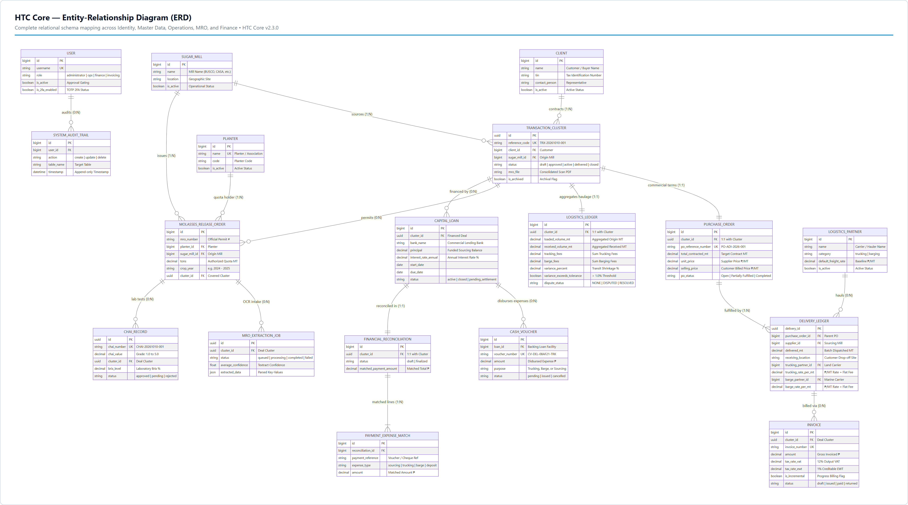

```mermaid
erDiagram
    %% Tier 1: Master Counterparties & Auth
    USER ||--o{ SYSTEM_AUDIT_TRAIL : "audits (0:N)"
    CLIENT ||--o{ TRANSACTION_CLUSTER : "contracts (1:N)"
    SUGAR_MILL ||--o{ TRANSACTION_CLUSTER : "sources (1:N)"
    SUGAR_MILL ||--o{ MOLASSES_RELEASE_ORDER : "issues (1:N)"
    PLANTER ||--o{ MOLASSES_RELEASE_ORDER : "quota holder (1:N)"

    %% Tier 2: Commercial Contract Core
    TRANSACTION_CLUSTER ||--|| PURCHASE_ORDER : "commercial terms (1:1)"
    TRANSACTION_CLUSTER ||--|| LOGISTICS_LEDGER : "aggregates haulage (1:1)"
    TRANSACTION_CLUSTER ||--o{ MOLASSES_RELEASE_ORDER : "permits (0:N)"
    TRANSACTION_CLUSTER ||--o{ CAPITAL_LOAN : "financed by (0:N)"

    %% Tier 3: Logistics Execution & Lab QA
    PURCHASE_ORDER ||--|{ DELIVERY_LEDGER : "fulfilled by (1:N)"
    LOGISTICS_PARTNER ||--o{ DELIVERY_LEDGER : "hauls (0:N)"
    MOLASSES_RELEASE_ORDER ||--o{ MRO_EXTRACTION_JOB : "OCR intake (0:N)"
    MOLASSES_RELEASE_ORDER ||--o{ CHAI_RECORD : "lab tests (0:N)"

    %% Tier 4: Invoicing, Outlays & Reconciliation
    DELIVERY_LEDGER ||--o{ INVOICE : "billed via (0:N)"
    CAPITAL_LOAN ||--o{ CASH_VOUCHER : "disburses expenses (0:N)"
    CAPITAL_LOAN ||--|| FINANCIAL_RECONCILIATION : "reconciled in (1:1)"
    FINANCIAL_RECONCILIATION ||--|{ PAYMENT_EXPENSE_MATCH : "matched lines (1:N)"

    CLIENT {
        bigint id PK
        string name "Customer / Buyer Name"
        string tin "Tax Identification Number"
        string contact_person "Representative"
        boolean is_active "Active Status"
    }
    SUGAR_MILL {
        bigint id PK
        string name "Mill Name (BUSCO, CASA, etc.)"
        string location "Geographic Site"
        boolean is_active "Operational Status"
    }
    PLANTER {
        bigint id PK
        string name UK "Planter / Association"
        string code "Planter Code"
        boolean is_active "Active Status"
    }
    LOGISTICS_PARTNER {
        bigint id PK
        string name "Carrier / Hauler Name"
        string category "trucking | barging"
        decimal default_freight_rate "Baseline ₱/MT"
        boolean is_active "Active Status"
    }
    USER {
        bigint id PK
        string username UK
        string role "administrator | ops | finance | invoicing"
        boolean is_active "Approval Gating"
        boolean is_2fa_enabled "TOTP 2FA Status"
    }
    SYSTEM_AUDIT_TRAIL {
        bigint id PK
        bigint user_id FK
        string action "create | update | delete"
        string table_name "Target Table"
        datetime timestamp "Append-only Timestamp"
    }
    TRANSACTION_CLUSTER {
        uuid id PK
        string reference_code UK "TRX-20261010-001"
        bigint client_id FK "Customer"
        bigint sugar_mill_id FK "Origin Mill"
        string status "draft | approved | active | delivered | closed"
        string mro_file "Consolidated Scan PDF"
        boolean is_archived "Archival Flag"
    }
    PURCHASE_ORDER {
        bigint id PK
        uuid cluster_id FK "1:1 with Cluster"
        string po_reference_number UK "PO-ADI-2026-001"
        decimal total_contracted_mt "Target Contract MT"
        decimal unit_price "Supplier Price ₱/MT"
        decimal selling_price "Customer Billed Price ₱/MT"
        string po_status "Open | Partially Fulfilled | Completed"
    }
    LOGISTICS_LEDGER {
        bigint id PK
        uuid cluster_id FK "1:1 with Cluster"
        decimal loaded_volume_mt "Aggregated Origin MT"
        decimal received_volume_mt "Aggregated Received MT"
        decimal tracking_fees "Sum Trucking Fees"
        decimal barge_fees "Sum Barging Fees"
        decimal variance_percent "Transit Shrinkage %"
        boolean variance_exceeds_tolerance "> 1.0% Threshold"
        string dispute_status "NONE | DISPUTED | RESOLVED"
    }
    MOLASSES_RELEASE_ORDER {
        bigint id PK
        string mro_number "Official Permit #"
        bigint planter_id FK "Planter"
        bigint sugar_mill_id FK "Origin Mill"
        decimal tons "Authorized Quota MT"
        string crop_year "e.g. 2024 - 2025"
        uuid cluster_id FK "Covered Cluster"
    }
    DELIVERY_LEDGER {
        uuid delivery_id PK
        bigint purchase_order_id FK "Parent PO"
        bigint supplier_id FK "Sourcing Mill"
        decimal delivered_mt "Batch Dispatched MT"
        string receiving_location "Customer Drop-off Site"
        bigint trucking_partner_id FK "Land Carrier"
        decimal trucking_rate_per_mt "₱/MT Rate + Flat Fee"
        bigint barge_partner_id FK "Marine Carrier"
        decimal barge_rate_per_mt "₱/MT Rate + Flat Fee"
    }
    CHAI_RECORD {
        uuid id PK
        string chai_number UK "CHAI-20261010-001"
        decimal chai_value "Grade: 1.0 to 5.0"
        uuid cluster_id FK "Deal Cluster"
        decimal brix_level "Laboratory Brix %"
        string status "approved | pending | rejected"
    }
    MRO_EXTRACTION_JOB {
        uuid id PK
        uuid cluster_id FK "Deal Cluster"
        string status "queued | processing | completed | failed"
        float average_confidence "Textract Confidence"
        json extracted_data "Parsed Key-Values"
    }
    INVOICE {
        bigint id PK
        uuid cluster_id FK "Deal Cluster"
        string invoice_number UK
        decimal amount "Gross Invoiced ₱"
        decimal tax_rate_vat "12% Output VAT"
        decimal tax_rate_ewt "1% Creditable EWT"
        boolean is_incremental "Progress Billing Flag"
        string status "draft | issued | paid | returned"
    }
    CAPITAL_LOAN {
        bigint id PK
        uuid cluster_id FK "Financed Deal"
        string bank_name "Commercial Lending Bank"
        decimal principal "Funded Sourcing Balance"
        decimal interest_rate_annual "Annual Interest Rate %"
        date start_date
        date due_date
        string status "active | closed | pending_settlement"
    }
    CASH_VOUCHER {
        bigint id PK
        bigint loan_id FK "Backing Loan Facility"
        string voucher_number UK "CV-DEL-08AF21-TRK"
        decimal amount "Disbursed Expense ₱"
        string purpose "Trucking, Barge, or Sourcing"
        string status "pending | issued | cancelled"
    }
    FINANCIAL_RECONCILIATION {
        bigint id PK
        uuid cluster_id FK "1:1 with Cluster"
        string status "draft | finalized"
        decimal matched_payment_amount "Matched Total ₱"
    }
    PAYMENT_EXPENSE_MATCH {
        bigint id PK
        bigint reconciliation_id FK
        string payment_reference "Voucher / Cheque Ref"
        string expense_type "sourcing | trucking | barge | deposit"
        decimal amount "Matched Amount ₱"
    }
```

---

## 2. Data Flow Diagrams (DFD)

> [!IMPORTANT]
> **Internal Staff Access Boundary (No External User Accounts):**
> HTC Core is strictly a private, role-based internal enterprise system. **External commercial counterparties—specifically Financing Banks, Customers, Sugar Mills, and Logistics Haulers—do NOT have user accounts or web portal access.**
> All real-world offline inputs—such as physical Bank Clearance Advices (`settlement_receipt_number`), paper cheques, customer purchase contracts, mill delivery receipts (MDR), and carrier waybills—are received via physical, phone, or email channels and entered directly into the portal by authorized HTC internal staff (`operations_management`, `operations`, `finance`, `invoicing`).

### 2.1 Level 0 DFD: Context Diagram
The Level 0 Context Diagram maps how data flows across the system boundary between authenticated internal staff, automated cloud microservices, and offline external business counterparties.

> 🖼️ **Rendered Diagram Image:** [Download High-Res PNG](diagrams/02_dfd_level0_context_diagram.png) | [Vector SVG](diagrams/02_dfd_level0_context_diagram.svg) | [Draw.io File](diagrams/02_dfd_level0_context_diagram.drawio) | [Raw XML](diagrams/02_dfd_level0_context_diagram.xml)
>
> 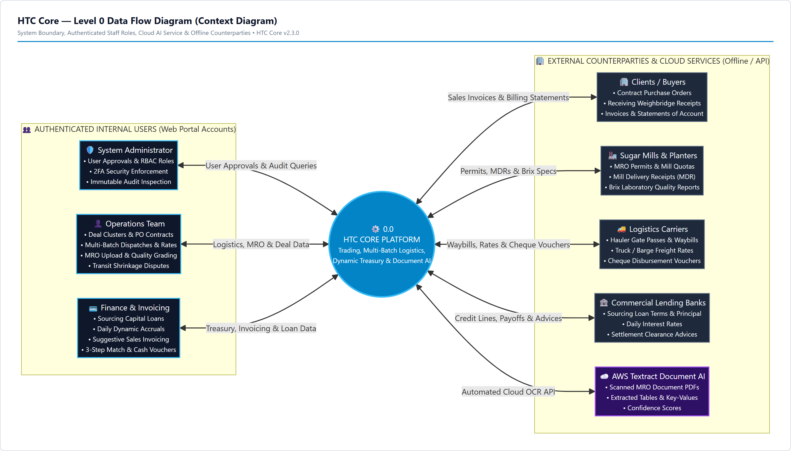

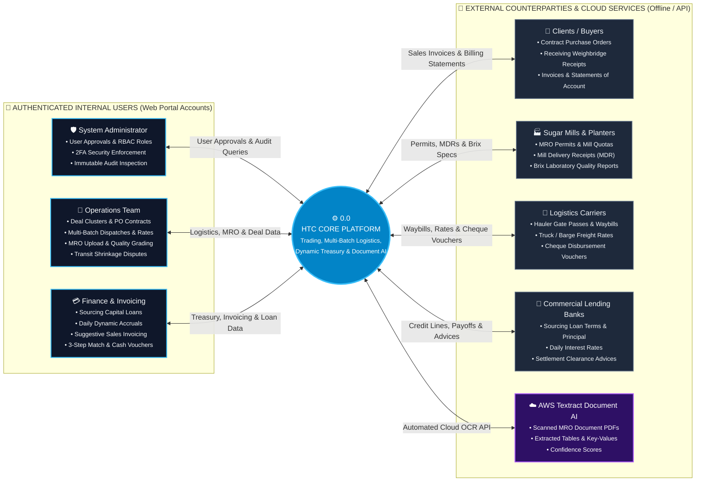

---

### 2.2 Level 1 DFD: Process Decomposition Diagram
The Level 1 DFD decomposes HTC Core into its **10 major operational sub-processes**, showing data flows driven by internal authenticated staff and automated services across the 8 data stores.

> 🖼️ **Rendered Diagram Image:** [Download High-Res PNG](diagrams/03_dfd_level1_process_decomposition.png) | [Vector SVG](diagrams/03_dfd_level1_process_decomposition.svg) | [Draw.io File](diagrams/03_dfd_level1_process_decomposition.drawio) | [Raw XML](diagrams/03_dfd_level1_process_decomposition.xml)
>
> 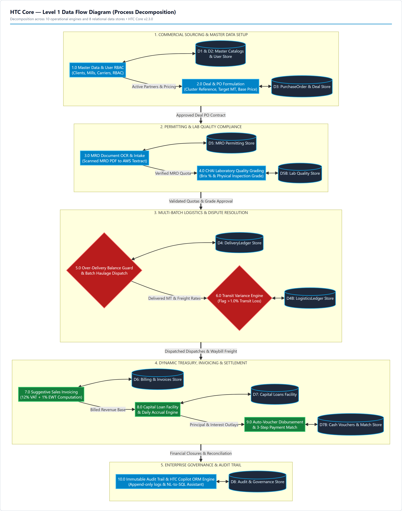

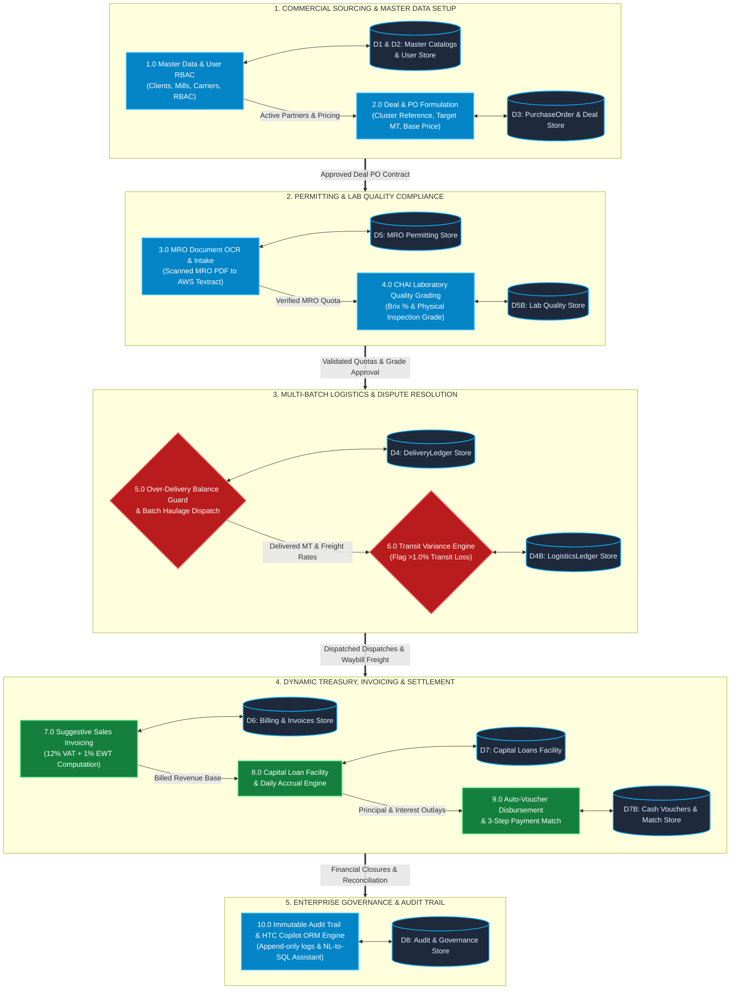

---

### 2.3 Level 2 DFD: Process 5.0 (Parent PO & Incremental Multi-Batch Delivery Execution)
To highlight the drastic changes made to parent-child PO logistics, this Level 2 DFD drills directly into **Process 5.0**.

> 🖼️ **Rendered Diagram Image:** [Download High-Res PNG](diagrams/04_dfd_level2_multi_batch_delivery.png) | [Vector SVG](diagrams/04_dfd_level2_multi_batch_delivery.svg) | [Draw.io File](diagrams/04_dfd_level2_multi_batch_delivery.drawio) | [Raw XML](diagrams/04_dfd_level2_multi_batch_delivery.xml)
>
> 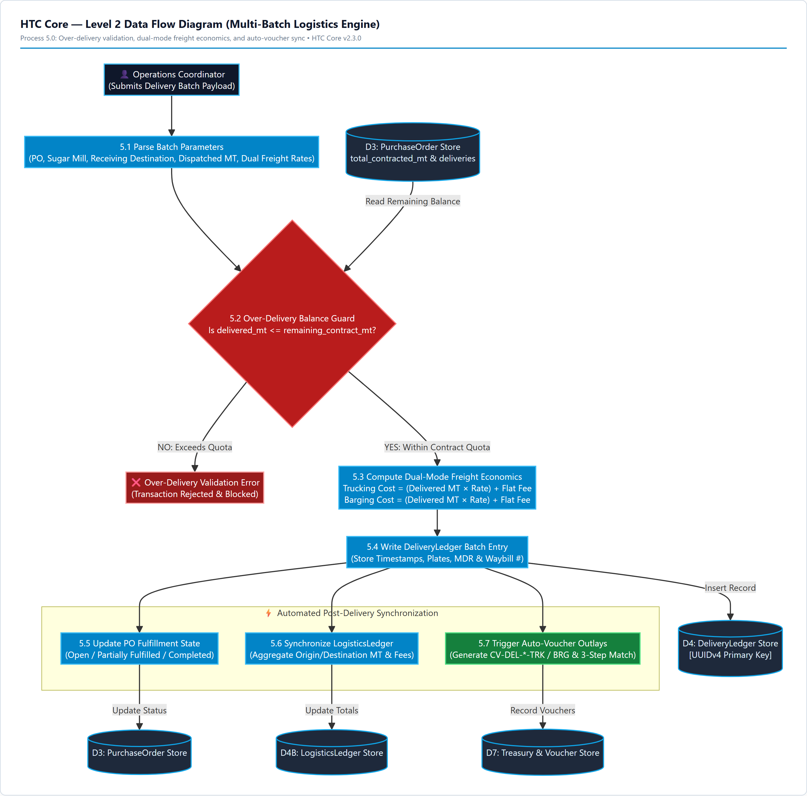

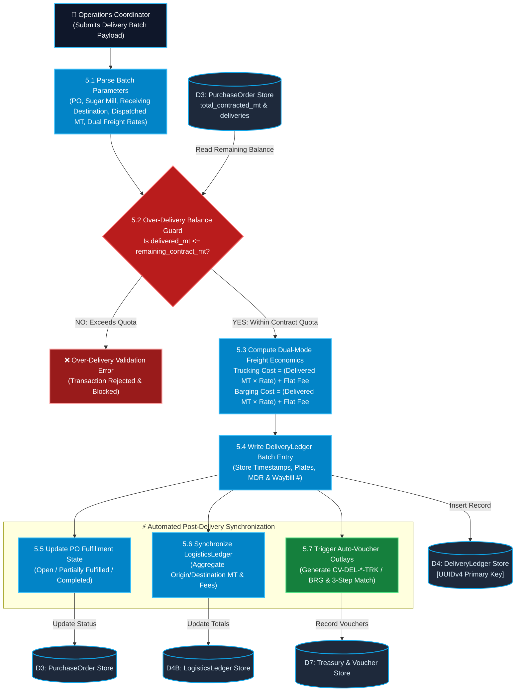

---

## 3. Comprehensive Database Schema Specification

This schema dictionary represents the **PostgreSQL 16** production database architecture backing HTC Core.

> 🖼️ **Rendered Schema Table Sheet:** [Download High-Res PNG](diagrams/06_database_schema_summary_tables.png)
>
> 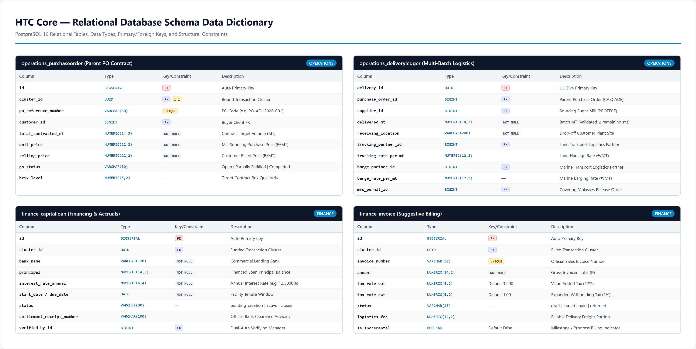

### 3.1 `accounts_user` (Custom User & Identity Model)
Inherits from Django `AbstractUser`, adding role-based security, 2FA, and registration gating.

| Column | Data Type | Nullable | Default | Constraints / Index | Business Role & Logic |
|---|---|---|---|---|---|
| `id` | `BIGSERIAL` | No | Auto | `PK` | Unique user account ID |
| `username` | `VARCHAR(150)` | No | — | `UNIQUE, INDEX` | Corporate login username |
| `email` | `VARCHAR(254)` | Yes | `""` | — | User contact & notification email |
| `password` | `VARCHAR(128)` | No | — | — | PBKDF2 SHA-256 hashed password |
| `role` | `VARCHAR(30)` | No | `'operations'` | `INDEX` | Choices: `administrator`, `operations_management`, `operations`, `finance`, `invoicing` |
| `is_active` | `BOOLEAN` | No | `False` | `INDEX` | **Registration Gate**: Set to `False` upon signup until explicitly approved by Administrator |
| `is_2fa_enabled` | `BOOLEAN` | No | `False` | — | Indicates whether TOTP 2FA is enforced upon session login |
| `otp_secret` | `VARCHAR(32)` | Yes | `NULL` | — | Base32-encoded cryptographic TOTP secret for authenticator apps |
| `backup_codes` | `JSONB` | No | `'[]'` | — | Array of 5 hashed single-use emergency recovery codes |
| `avatar` | `VARCHAR(100)` | Yes | `NULL` | — | Path to uploaded user profile image in media storage |

---

### 3.2 `masters_*` (Master Data Catalog)

#### `masters_client` (Customer Directory)
| Column | Data Type | Nullable | Default | Constraints | Description |
|---|---|---|---|---|---|
| `id` | `BIGSERIAL` | No | Auto | `PK` | Client primary key |
| `name` | `VARCHAR(200)` | No | — | `INDEX` | Customer organization name (e.g. San Miguel Corp) |
| `tin` | `VARCHAR(50)` | Yes | `""` | — | Bureau of Internal Revenue Tax Identification Number |
| `address` | `TEXT` | Yes | `""` | — | Official billing and drop-off facility address |
| `contact_person` | `VARCHAR(120)` | Yes | `""` | — | Authorized commercial representative |
| `contact_phone` | `VARCHAR(50)` | Yes | `""` | — | Representative direct telephone / mobile |
| `email` | `VARCHAR(254)` | Yes | `""` | — | Invoicing destination email |
| `is_active` | `BOOLEAN` | No | `True` | `INDEX` | Active status in dropdown lookups |

#### `masters_sugarmill` (Origin Suppliers)
| Column | Data Type | Nullable | Default | Constraints | Description |
|---|---|---|---|---|---|
| `id` | `BIGSERIAL` | No | Auto | `PK` | Sugar mill primary key |
| `name` | `VARCHAR(200)` | No | — | `INDEX` | Mill name (e.g. BUSCO, CASA, HPCo, Lopez Sugar) |
| `location` | `VARCHAR(200)` | Yes | `""` | — | Geographic site (e.g. Bukidnon, Negros Occidental) |
| `contact_person` | `VARCHAR(120)` | Yes | `""` | — | Resident logistics coordinator / warehouseman |
| `is_active` | `BOOLEAN` | No | `True` | `INDEX` | Sourcing operational status |

#### `masters_logisticspartner` (Carriers & Fleets)
| Column | Data Type | Nullable | Default | Constraints | Description |
|---|---|---|---|---|---|
| `id` | `BIGSERIAL` | No | Auto | `PK` | Carrier primary key |
| `name` | `VARCHAR(200)` | No | — | `INDEX` | Hauler name (e.g. Solid Haulers, FastBarge Inc) |
| `category` | `VARCHAR(20)` | No | `'barging'` | — | Enum: `trucking` (Land) or `barging` (Marine) |
| `region` | `VARCHAR(150)` | Yes | `'Visayas / Luzon'` | — | Primary transit corridor |
| `fleet_count` | `INTEGER` | No | `0` | — | Active trucks or marine barge vessel count |
| `default_freight_rate`| `NUMERIC(12,2)`| No | `0.00` | — | Baseline quotation rate (₱/MT) |
| `is_active` | `BOOLEAN` | No | `True` | `INDEX` | Carrier dispatch eligibility |

---

### 3.3 `operations_*` (Core Trading, PO, Multi-Batch & Logistics)

#### `operations_transactioncluster` (Master Transaction Envelope)
| Column | Data Type | Nullable | Default | Constraints | Business Logic & Rules |
|---|---|---|---|---|---|
| `id` | `UUID` | No | `gen_random_uuid()` | `PK` | Unique transaction cluster UUID |
| `reference_code` | `VARCHAR(50)` | No | — | `UNIQUE, INDEX` | Auto-generated code (e.g. `TRX-20261010-001`) |
| `client_id` | `BIGINT` | No | — | `FK -> masters_client` | Primary purchasing customer |
| `sugar_mill_id` | `BIGINT` | No | — | `FK -> masters_sugarmill` | Primary origin sugar mill |
| `status` | `VARCHAR(20)` | No | `'draft'` | `INDEX` | Workflow: `draft` -> `pending_approval` -> `approved` -> `active` -> `delivered` -> `closed` (or `returned`) |
| `submitted_at` | `TIMESTAMPTZ` | Yes | `NULL` | — | Submission timestamp for manager review |
| `approved_at` | `TIMESTAMPTZ` | Yes | `NULL` | — | Executive approval timestamp |
| `approved_by_id`| `BIGINT` | Yes | `NULL` | `FK -> accounts_user` | Operations Manager / Admin who approved deal |
| `rejection_comments`| `TEXT` | No | `""` | — | Mandatory comments if deal is returned / rejected |
| `mro_file` | `VARCHAR(100)` | Yes | `NULL` | — | Scanned PDF soft-copy of consolidated MRO release |
| `is_archived` | `BOOLEAN` | No | `False` | `INDEX` | True when closed, fully settled & archived |

#### `operations_purchaseorder` (Parent PO Contract)
| Column | Data Type | Nullable | Default | Constraints | Business Logic & Formulas |
|---|---|---|---|---|---|
| `id` | `BIGSERIAL` | No | Auto | `PK` | Purchase order header primary key |
| `cluster_id` | `UUID` | No | — | `UNIQUE, FK -> cluster` | 1:1 binding to master transaction cluster |
| `po_reference_number`| `VARCHAR(50)`| Yes | `NULL` | `UNIQUE, INDEX` | Standard customer PO ref (e.g. `PO-ADI-2026-001`) |
| `customer_id` | `BIGINT` | Yes | `NULL` | `FK -> masters_client` | Direct client pointer (mirrors cluster client) |
| `total_contracted_mt`| `NUMERIC(14,3)`| Yes | `NULL` | — | Total agreed contract volume (e.g. 10,000.000 MT) |
| `po_status` | `VARCHAR(30)` | No | `'Open'` | `INDEX` | State: `Open`, `Partially Fulfilled`, `Completed` |
| `volume_mt` | `NUMERIC(14,3)`| No | — | — | Baseline volume MT field |
| `unit_price` | `NUMERIC(12,2)`| No | — | — | Sourcing purchase price paid to mill (₱/MT) |
| `selling_price` | `NUMERIC(12,2)`| Yes | `NULL` | — | Gross billing price charged to customer (₱/MT) |
| `brix_level` | `NUMERIC(5,2)` | Yes | `NULL` | — | Target contractual sugar Brix percentage |

> **Dynamic PO Properties:**
> * `total_delivered_mt = SUM(deliveries.delivered_mt)`
> * `remaining_mt = max(0, total_contracted_mt - total_delivered_mt)`
> * `update_status()`: Auto-triggers on batch save: Sets `Completed` when `remaining_mt == 0`, `Partially Fulfilled` when `delivered_mt > 0`, and updates parent Cluster status to `DELIVERED`.

#### `operations_deliveryledger` (Multi-Batch Fulfillment Ledger)
| Column | Data Type | Nullable | Default | Constraints | Business Logic & Freight Formulas |
|---|---|---|---|---|---|
| `delivery_id` | `UUID` | No | `gen_random_uuid()` | `PK` | Delivery batch primary key |
| `purchase_order_id`| `BIGINT` | No | — | `FK -> purchaseorder` | Parent PO contract being fulfilled |
| `supplier_id` | `BIGINT` | No | — | `FK -> masters_sugarmill`| Mill origin sourcing this specific batch |
| `delivered_mt` | `NUMERIC(14,3)`| No | — | — | Batch quantity in MT (Validated `<= remaining_mt`) |
| `receiving_location`| `VARCHAR(200)`| No | — | — | Drop-off point (e.g. Balayan, ADI, Tank Farm) |
| `delivery_date` | `DATE` | No | `CURRENT_DATE` | — | Scheduled / actual arrival date |
| `dispatched_at` | `TIMESTAMPTZ` | Yes | `NULL` | — | Exact mill gate departure timestamp |
| `received_at` | `TIMESTAMPTZ` | Yes | `NULL` | — | Exact customer destination arrival timestamp |
| `trucking_partner_id`| `BIGINT` | Yes | `NULL` | `FK -> carrier` | Land hauler assigned to batch |
| `trucking_rate_per_mt`| `NUMERIC(12,2)`| No | `0.00` | — | Land freight rate (₱/MT) |
| `flat_trucking_fee`| `NUMERIC(12,2)`| No | `0.00` | — | Lump-sum flat land transport fee |
| `barge_partner_id` | `BIGINT` | Yes | `NULL` | `FK -> carrier` | Marine barging hauler assigned to batch |
| `vessel_or_barge_name`| `VARCHAR(100)`| Yes | `""` | — | Barge or tugboat identification |
| `barge_rate_per_mt` | `NUMERIC(12,2)`| No | `0.00` | — | Marine freight rate (₱/MT) |
| `flat_barge_fee` | `NUMERIC(12,2)`| No | `0.00` | — | Lump-sum flat marine transport fee |
| `mro_permit_id` | `BIGINT` | Yes | `NULL` | `FK -> mro` | Linked Molasses Release Order permit |
| `dr_number` | `VARCHAR(100)` | Yes | `""` | — | Delivery Receipt (DR) / Weighbridge ticket # |
| `waybill_number` | `VARCHAR(100)` | Yes | `""` | — | Mill Waybill / MDR reference # |

> **Freight Calculation Properties:**
> * `trucking_cost = (delivered_mt * trucking_rate_per_mt) + flat_trucking_fee`
> * `barge_cost = (delivered_mt * barge_rate_per_mt) + flat_barge_fee`
> * `total_freight_cost = trucking_cost + barge_cost`
> * `clean()`: Automatically rejects save if `delivered_mt > po.remaining_mt`.
> * `save()`: Auto-triggers `sync_cluster_logistics()` and `sync_delivery_expense_vouchers()`.

#### `operations_logisticsledger` (Aggregated Logistics & Dispute Engine)
| Column | Data Type | Nullable | Default | Constraints | Description |
|---|---|---|---|---|---|
| `id` | `BIGSERIAL` | No | Auto | `PK` | Logistics ledger primary key |
| `cluster_id` | `UUID` | No | — | `UNIQUE, FK -> cluster` | 1:1 binding to master transaction cluster |
| `loaded_volume_mt` | `NUMERIC(14,3)`| No | — | — | Sum of origin loaded MT across batches |
| `received_volume_mt`| `NUMERIC(14,3)`| Yes | `NULL` | — | Sum of received weighbridge MT |
| `tracking_fees` | `NUMERIC(12,2)`| No | `0.00` | — | Sum of all batch land trucking costs |
| `barge_fees` | `NUMERIC(12,2)`| No | `0.00` | — | Sum of all batch marine barging costs |
| `variance_percent` | `NUMERIC(8,4)` | Yes | `NULL` | — | `(|loaded_mt - received_mt| / loaded_mt) * 100` |
| `variance_exceeds_tolerance`| `BOOLEAN`| No | `False` | — | Flagged `True` if `variance_percent > 1.0%` |
| `dispute_status` | `VARCHAR(20)` | No | `'NONE'` | — | Choices: `NONE`, `DISPUTED`, `RESOLVED` |
| `resolution_type` | `VARCHAR(30)` | Yes | `NULL` | — | `CONCEDED`, `BILLING_ADJUSTED`, `BARGE_PENALTY`, `WAIVED` |
| `resolution_notes` | `TEXT` | No | `""` | — | Mandatory explanation for dispute settlement |

#### `operations_molassesreleaseorder` (MRO Permits)
| Column | Data Type | Nullable | Default | Constraints | Description |
|---|---|---|---|---|---|
| `id` | `BIGSERIAL` | No | Auto | `PK` | MRO permit primary key |
| `mro_number` | `VARCHAR(50)` | No | — | `INDEX` | Official MRO code printed on permit |
| `planter_id` | `BIGINT` | No | — | `FK -> masters_planter`| Planter / Association allocating volume |
| `sugar_mill_id` | `BIGINT` | Yes | `NULL` | `FK -> masters_sugarmill`| Issuing sugar mill |
| `tons` | `NUMERIC(14,5)`| No | — | — | Quota volume in Metric Tons (5 decimal precision) |
| `crop_year` | `VARCHAR(30)` | No | — | `INDEX` | Normalized milling season (e.g. `2024 - 2025`) |
| `cluster_id` | `UUID` | Yes | `NULL` | `FK -> cluster` | Parent cluster contract linkage |
| `scanned_file` | `VARCHAR(100)` | Yes | `NULL` | — | Scanned soft-copy document (PDF/Image) |

#### `operations_chairecord` (Quality Lab Inspection)
| Column | Data Type | Nullable | Default | Constraints | Description |
|---|---|---|---|---|---|
| `id` | `UUID` | No | `gen_random_uuid()` | `PK` | CHAI record UUID |
| `chai_number` | `VARCHAR(50)` | No | — | `UNIQUE, INDEX` | Official certificate code (e.g. `CHAI-20261010-001`) |
| `chai_value` | `NUMERIC(4,1)` | No | `1.0` | — | Standard numerical grade (1.0 to 5.0) |
| `cluster_id` | `UUID` | Yes | `NULL` | `FK -> cluster` | Associated transaction cluster |
| `sugar_mill_id` | `BIGINT` | Yes | `NULL` | `FK -> masters_sugarmill`| Tested origin sugar mill |
| `brix_level` | `NUMERIC(5,2)` | No | `85.00` | — | Laboratory measured Brix % |
| `purity_percent` | `NUMERIC(5,2)` | Yes | `NULL` | — | Apparent purity % |
| `total_sugars_percent`| `NUMERIC(5,2)`| Yes | `NULL` | — | Total fermentable sugars % |
| `status` | `VARCHAR(20)` | No | `'approved'`| — | Inspection status: `approved`, `pending`, `rejected` |

#### `operations_mroextractionjob` (AWS Textract Document AI OCR)
| Column | Data Type | Nullable | Default | Constraints | Description |
|---|---|---|---|---|---|
| `id` | `UUID` | No | `gen_random_uuid()` | `PK` | OCR extraction job UUID |
| `cluster_id` | `UUID` | No | — | `FK -> cluster` | Target cluster for extracted MRO lines |
| `document` | `VARCHAR(100)` | No | — | — | Uploaded raw scanned document file |
| `status` | `VARCHAR(20)` | No | `'queued'` | `INDEX` | Status: `queued`, `processing`, `completed`, `failed` |
| `average_confidence`| `FLOAT` | Yes | `NULL` | — | Average OCR block recognition confidence % |
| `extracted_data` | `JSONB` | Yes | `NULL` | — | Key-value blocks and parsed table rows |
| `error_message` | `TEXT` | No | `""` | — | Error log if Textract execution fails |

---

### 3.4 `finance_*` (Treasury, Invoicing, Vouchers & Loans)

#### `finance_invoice` (Suggestive Billing & Tax Ledger)
| Column | Data Type | Nullable | Default | Constraints | Description |
|---|---|---|---|---|---|
| `id` | `BIGSERIAL` | No | Auto | `PK` | Sales invoice primary key |
| `cluster_id` | `UUID` | No | — | `FK -> cluster` | Sourced transaction cluster |
| `invoice_number` | `VARCHAR(50)` | No | — | `UNIQUE, INDEX` | Official sales invoice reference number |
| `amount` | `NUMERIC(14,2)`| No | — | — | Gross billed amount (₱) |
| `issued_at` | `DATE` | No | `CURRENT_DATE` | — | Billing issue date |
| `due_date` | `DATE` | Yes | `NULL` | — | Receivable payment due date |
| `status` | `VARCHAR(20)` | No | `'draft'` | `INDEX` | Choices: `draft`, `issued`, `paid`, `returned` |
| `tax_rate_vat` | `NUMERIC(5,2)` | No | `12.00` | — | Output Value Added Tax rate (Default 12.00%) |
| `tax_rate_ewt` | `NUMERIC(5,2)` | No | `1.00` | — | Creditable Expanded Withholding Tax rate (Default 1.00%) |
| `is_incremental` | `BOOLEAN` | No | `False` | — | Indicates partial / milestone progress billing |
| `incremental_percentage`| `NUMERIC(5,2)`| Yes | `NULL` | — | Specified milestone % (e.g. 50.00%, 25.00%) |
| `logistics_fee` | `NUMERIC(14,2)`| No | `0.00` | — | Billable logistics fee parsed from deliveries |

> **Tax Calculation Formulas:**
> * `net_vat_base = amount / (1.00 + (tax_rate_vat / 100)) = amount / 1.12`
> * `vat_amount = amount - net_vat_base`
> * `ewt_amount = net_vat_base * (tax_rate_ewt / 100)`
> * `net_amount_after_tax = amount - ewt_amount` (Expected Cash Collection)

#### `finance_cashvoucher` (Cheque Expense Disbursements)
| Column | Data Type | Nullable | Default | Constraints | Description |
|---|---|---|---|---|---|
| `id` | `BIGSERIAL` | No | Auto | `PK` | Cash voucher primary key |
| `cluster_id` | `UUID` | No | — | `FK -> cluster` | Associated transaction cluster |
| `loan_id` | `BIGINT` | Yes | `NULL` | `FK -> capitalloan`| Backing capital financing facility |
| `voucher_number` | `VARCHAR(50)` | No | — | `UNIQUE, INDEX` | Unique code (e.g. `CV-DEL-08AF21-TRK`) |
| `amount` | `NUMERIC(14,2)`| No | — | — | Disbursed expense amount (₱) |
| `purpose` | `VARCHAR(200)` | No | — | — | Description of land freight, barge, or sourcing |
| `status` | `VARCHAR(20)` | No | `'pending'` | — | Choices: `pending`, `issued`, `cancelled` |
| `cheque_number` | `VARCHAR(50)` | Yes | `""` | — | Physical bank cheque reference number |
| `cheque_date` | `DATE` | Yes | `NULL` | — | Physical cheque issuance date |

#### `finance_capitalloan` (Financing & Dynamic Accruals)
| Column | Data Type | Nullable | Default | Constraints | Description |
|---|---|---|---|---|---|
| `id` | `BIGSERIAL` | No | Auto | `PK` | Capital loan facility primary key |
| `cluster_id` | `UUID` | No | — | `FK -> cluster` | Sourced transaction cluster funded |
| `bank_name` | `VARCHAR(120)` | No | — | — | Lending institution (e.g. BDO, BPI, Security Bank) |
| `principal` | `NUMERIC(14,2)`| No | — | — | Funded principal sourcing balance |
| `interest_rate_annual`| `NUMERIC(6,4)`| No | — | — | Annual interest rate (e.g. 12.5000%) |
| `start_date` | `DATE` | No | — | — | Loan release date |
| `due_date` | `DATE` | No | — | — | Facility maturity date |
| `cheque_number` | `VARCHAR(50)` | Yes | `""` | — | Originating cheque reference number |
| `bank_account_number`| `VARCHAR(50)` | Yes | `""` | — | Originating bank account # |
| `logistics_deposit_percentage`| `NUMERIC(5,2)`| No | `50.00`| — | Deposit percentage (Default 50.00%) |
| `status` | `VARCHAR(30)` | No | `'pending_creation'`| — | `pending_creation` -> `active` -> `pending_settlement` -> `closed` (or `overdue` / `rejected`) |
| `settlement_receipt_number`| `VARCHAR(100)`| Yes | `""`| — | Bank official clearance / release advice # |
| `settlement_document`| `VARCHAR(100)`| Yes | `NULL` | — | Scanned PDF of bank settlement clearance |
| `verified_by_id` | `BIGINT` | Yes | `NULL` | `FK -> accounts_user`| Ops Manager / Admin dual-auth verification |
| `verified_at` | `TIMESTAMPTZ` | Yes | `NULL` | — | Dual-authorization verification timestamp |

> **Dynamic Daily Accrual Formulas:**
> * `days_outstanding = max((CURRENT_DATE - start_date), 0)` (Or capped at `due_date` once closed)
> * `daily_interest_cost = principal * (interest_rate_annual / 100 / 365)`
> * `accrued_interest = daily_interest_cost * days_outstanding`
> * `total_liability = principal + accrued_interest`
> * `funded_logistics_deposit = (logistics.tracking_fees + logistics.barge_fees) * 50%`

#### `finance_financialreconciliation` & `finance_paymentexpensematch`
* `FinancialReconciliation`: 1:1 anchor per cluster managing payment match state (`draft` vs `finalized`) and aggregate `matched_payment_amount`.
* `PaymentExpenseMatch`: Granular 3-step reconciliation records linking payment references to exact expense buckets (`sourcing`, `trucking`, `barge`, `logistics_deposit`, `other`).

---

### 3.5 `audit_*` & `chat_*` (Cross-Cutting Concerns)

#### `audit_systemaudittrail` (Immutable Append-Only Audit Log)
| Column | Data Type | Nullable | Default | Constraints | Description |
|---|---|---|---|---|---|
| `id` | `BIGSERIAL` | No | Auto | `PK` | Audit entry ID |
| `user_id` | `BIGINT` | Yes | `NULL` | `FK -> accounts_user`| User executing mutation (SET_NULL on user delete) |
| `action` | `VARCHAR(10)` | No | — | — | Mutation verb: `create`, `update`, `delete` |
| `table_name` | `VARCHAR(100)` | No | — | `INDEX` | Name of affected table (e.g. `operations_purchaseorder`) |
| `record_id` | `VARCHAR(64)` | No | — | `INDEX` | Record primary key (UUID or Integer string) |
| `old_values` | `JSONB` | No | `'{}'` | — | Full JSON snapshot prior to mutation |
| `new_values` | `JSONB` | No | `'{}'` | — | Full JSON snapshot after mutation |
| `timestamp` | `TIMESTAMPTZ` | No | `CURRENT_TIMESTAMP` | `INDEX` | Append-only execution timestamp |

> **Immutability Enforcement:** The model overrides `.save()` and `.delete()` to throw `ValueError("Audit trail entries are append-only and cannot be updated or deleted.")`.

#### `audit_notification` (Role-Targeted Alerts)
Stores operational and financial alerts categorized across `approval`, `variance`, `logistics`, `loan`, and `system` with severity levels (`info`, `warning`, `success`, `danger`).

#### `chat_chatmessage` (Contextual Team Collaboration)
Allows direct messages between users and context-threaded discussions anchored directly to specific `TransactionCluster` records (`cluster_id` FK).

---

## 4. Use Case Diagram

The Use Case Diagram maps the functional interactions between the **6 system actors** (5 authenticated internal staff roles + 1 automated cloud microservice) and the **9 functional use case packages**.

> 🖼️ **Rendered Diagram Image:** [Download High-Res PNG](diagrams/05_use_case_diagram.png) | [Vector SVG](diagrams/05_use_case_diagram.svg) | [Draw.io File](diagrams/05_use_case_diagram.drawio) | [Raw XML](diagrams/05_use_case_diagram.xml)
>
> 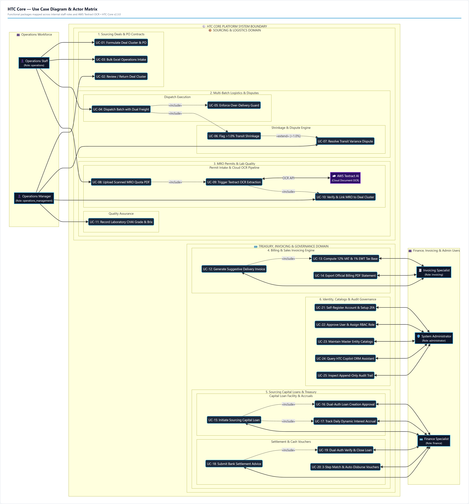

> [!NOTE]
> **Actors in HTC Core are 100% Internal Staff + AWS Textract:**
> External business institutions (Financing Banks, Customers, Mills, Fleets) are real-world counterparties, not actors on the website. For instance, when a bank issues an offline loan clearance advice, the **Finance Specialist** inputs the receipt number and uploads the clearance scan (`UC-25`), and the **Operations Manager / Administrator** reviews and executes dual-authorization verification (`UC-26`).

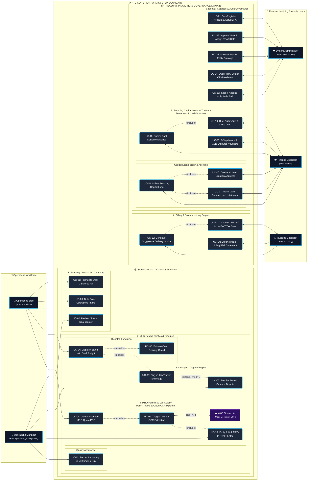

---

## 5. Traceability Matrix: What Changed and Why

| Subsystem | Previous Legacy Architecture | Current Post-Upgrade Architecture | Technical Rationale & Business Impact |
|---|---|---|---|
| **Contract Fulfillment** | Flat 1:1 single-dispatch model (`1 PO = 1 Delivery`). | **Parent PO (1:N) Multi-Batch Delivery Engine** (`PurchaseOrder` -> `DeliveryLedger[]`). | Accommodates real-world industrial sugar trading: 10,000 MT contracts are fulfilled over months across multiple sugar mills and drop-off customer sites. |
| **Logistics & Freight** | Single unclassified hauler name with flat estimated fees. | **Dual-Carrier Classification** (Dedicated land `trucking_partner` and marine `barge_partner` with ₱/MT rates and flat fees). | Prevents shipping cost distortion; enables exact freight accruals and profit margin calculation per batch. |
| **Shrinkage & Variance** | Late manual spreadsheet comparison of transit loss. | **Automated 1.0% Variance Guard & Dispute Workflow** (`NONE`, `DISPUTED`, `RESOLVED` with 4 resolution actions). | Eliminates unmonitored loss during sea/land transit; automatically alerts managers and enforces financial resolution before archiving. |
| **MRO Release Permits** | Loose paper permits filed manually without cluster linkage. | **Direct MRO Cluster Binding & AWS Textract OCR Pipeline** (`MROExtractionJob` with side-by-side scan preview). | Prevents double-allocation or expired release orders; provides rapid digital verification directly from the PO workspace. |
| **Quality Control** | Simple unstructured text note for Brix. | **Formal CHAI Quality Certification Model** (`CHAIRecord` with 1.0 to 5.0 grades, Brix %, purity %, and approval gating). | Enforces strict sugar specifications required by premium industrial distillers and food manufacturers. |
| **Customer Invoicing** | Manual calculation prone to volume and tax formula errors. | **Suggestive Delivery Billing Engine** (`delivered_mt * selling_price`, automatic 12% VAT and 1% EWT breakdown). | Accelerates time-to-invoice from weeks to minutes, matching actual delivered weighbridge tonnage directly. |
| **Capital Financing** | Static loan records without interest progression. | **Dynamic Daily Interest Accruals** (`accrued_interest` calculated daily, 50% logistics deposit funding, dual-auth creation/settlement). | Guarantees exact repayment liabilities to commercial banks, avoiding surprise interest penalties upon loan settlement. |
| **Authentication & RBAC** | Simple Django admin login with immediate open access. | **Admin Gating + TOTP 2FA + Single-Use Recovery Codes + 5 Distinct Roles**. | Enterprise security compliance protecting high-value transactions; zero unauthorized access for new sign-ups. |
| **User Experience** | Standard default web layout difficult for senior executives. | **Persistent High-Legibility Mode (`A+`) & High-Contrast Themes**. | Tailored for senior commodity traders and operational executives, ensuring effortless readability on factory floors and remote desks. |
